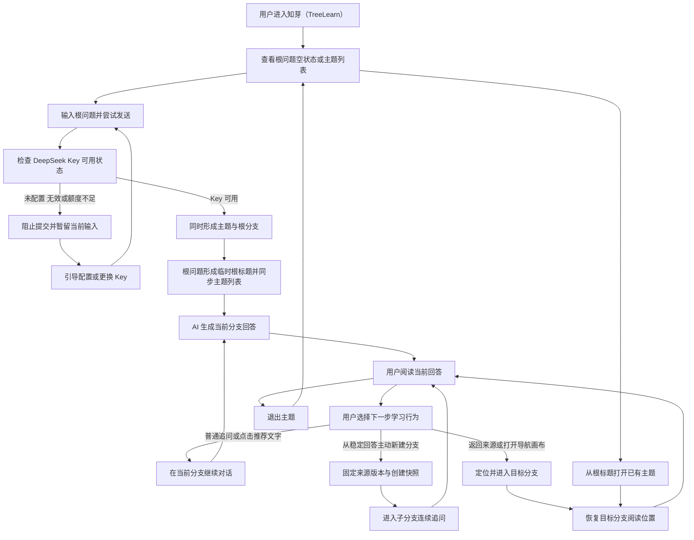

# 产品需求文档（PRD）

**文档版本**：V3.0  
**创建日期**：2026-09-20  
**需求名称**：知芽（TreeLearn）  
**创建人**：prd-write-agent

---

# 1. 需求背景与来源

## 1.1 业务现状与痛点

- **业务现象**：用户本人在普通 AI 聊天工具中提出 q1、阅读 a1 时产生 q2；探究 q2 及后续疑问后，a1 已位于长对话上方，用户难以回到原处继续阅读。（BASE-01）
- **核心痛点**：
  1. **用户侧**：线性会话将不同回答衍生的追问按时间混排，主问题与临时探索相互干扰，来源位置难以找回，后续回答使用的上下文不再专一。（BASE-01、BASE-02）
  2. **产品闭环侧**：若主题和根分支分别维护名称，同一棵树会出现两套显示身份；若根分支可归档，完整主题可能从日常结构中消失；若无可用 Key 时仍创建主题或根分支，主题列表会留下未真正开始的空树。（BASE-03）
- **不做 vs 做的价值对比**：

| 维度 | 不做的负面影响 | 做了之后的核心价值 |
| :--- | :--- | :--- |
| 用户侧 | 用户继续在长会话中滚动寻找原回答，或另开聊天并复述背景；原阅读位置、疑问来源和上下文边界难以保留，具体时间损失未量化。（BASE-01、BASE-02） | 用户可从稳定回答建立隔离分支，探索后回到来源位置，并通过树状结构了解真实延伸方向。（BASE-07 至 BASE-13、BASE-16） |
| 产品闭环侧 | 主题身份、根节点整理边界与首次提交状态可能相互冲突，导致树结构含义不稳定。（BASE-03） | 主题列表复用根分支标题，根分支不可归档；无可用 Key 时不产生主题或根分支，只有可用 Key 下提交根问题才形成一棵树。（BASE-05、BASE-06、BASE-14、BASE-18） |
| 业务侧 | 本项目为个人自用，无业务收益损失口径。（BASE-04） | 以功能场景验收知芽（TreeLearn）的树状分支学习闭环，不声称已有群体或商业收益。（BASE-04） |

## 1.2 需求来源

- [x] **用户反馈**：需求发起人本人描述了 q1 → a1 → q2 连续探索后难以找回 a1、上下文混杂的实际经历。（BASE-01、BASE-02）
- [ ] **数据分析**：本期无频次、耗时、群体样本或业务指标数据，不作推断。
- [ ] **战略规划**：个人自用项目，本期无商业化或组织战略目标。
- **用研状态与证据边界**：本期未执行外部用户研究，这是用户基于个人自用范围作出的明确决定；现有依据仅来自需求发起人本人的场景描述，不能将发生频率、替代方案代价或收益外推至其他职场人。（BASE-01、BASE-02、BASE-04）
- **边界冻结**：用户本人已于 2026-09-20 明确回复“确认边界冻结”，V3.0 以已冻结的需求基准为唯一需求来源。

---

# 2. 需求价值与人群分析

## 2.1 目标用户与场景（JTBD）

| 用户类型 | 优先级 | 典型角色 | 核心任务（JTBD：我要……以便……） | 核心痛点 |
| :--- | :--- | :--- | :--- | :--- |
| 核心用户 | P0 | 因工作需要持续学习陌生领域的职场人；本期实际使用者为需求发起人本人 | 当我为工作学习陌生知识时，我要从空状态提交根问题并以根标题识别主题；在阅读稳定回答时保留来源另开独立路径深入追问；探索后回到原处继续学习，并能从主题列表重新打开该树。（BASE-01、BASE-05 至 BASE-09） | 线性对话混杂主线与临时探索；来源和阅读现场难以找回；主题身份、根节点整理与首次提交缺少一致边界。（BASE-01、BASE-02、BASE-03） |
| 次要用户 | 不定义 | 本期不定义次要用户群 | 本期不承担群体推广验收，不扩展面向泛自主学习者的专属流程。（BASE-04） | 不适用 |

---

# 3. 业务目标

## 3.1 可量化核心指标

| 指标名称 | 统计口径（分子/分母） | 目标值 | 最低可接受值（底线） | 测量周期 |
| :--- | :--- | :--- | :--- | :--- |
| 业务 KPI 不适用 | 用户明确本期不设业务指标，因此无分子、分母或当前基线；不把功能测试通过率伪装成业务指标 | 本期不设 | 本期不设 | 不适用 |

## 3.2 体验目标（非量化）

- 用户能够完成“空状态提交根问题 → 以根标题识别主题 → 深入分叉 → 找回来源 → 退出后重开主题”的完整链路。（BASE-05、BASE-06、BASE-07、BASE-09）
- 用户从 a1 创建子分支并完成探索后，能够回到 a1 离开时的位置继续阅读或提问，且父分支正常回答不受子分支内容污染。（BASE-08、BASE-09）
- 在深层级和大量同级分支中，用户仍可通过祖先路径、最近使用、更多、搜索及画布识别并找到延伸方向。（BASE-10、BASE-11）
- 功能验收不得出现主题显示身份与根标题分离、无可用 Key 后留下主题或根分支、根分支被归档、跨分支回答串扰、父分支后续内容改写出生快照、部分回答被用于分叉、失败重试重复创建消息或分支，以及未明确告知的数据丢失。（BASE-05 至 BASE-08、BASE-14、BASE-15、BASE-17 至 BASE-19）

---

# 4. 竞品分析

> 本次需求未执行用研环节，也未形成系统竞品分析；本章不补写竞品、竞品能力或对标结论。

## 4.1 核心对标矩阵

本期无经用研确认的对标矩阵，不填充竞品信息。

## 4.2 差异化策略

本期不基于竞品推导差异化策略。知芽（TreeLearn）的产品范围仅依据冻结需求：主题以根分支标题作为唯一显示身份，从稳定回答建立独立分支，用创建快照固定历史依据，并通过逐层导航与总览画布找回内容。（BASE-06 至 BASE-11、BASE-15）

---

# 5. 业务流程

## 5.1 核心业务流程图

流程来源：BASE-05 至 BASE-11、BASE-15、BASE-16、BASE-18。

## 5.2 关键分支与异常流向

- **首次提交原子性**：用户输入根问题并尝试发送 → Key 未配置、无效或额度不足时阻止提交，输入可暂留当前界面，但不形成主题、根分支或树节点 → Key 可用后再次提交，主题与根分支作为同一次用户结果形成。（BASE-05、BASE-18）
- **根回答失败**：主题和根分支已成功形成后，回答出现网络、超时或生成失败 → 保留主题、根问题、根分支与部分回答 → 在原位置重试，不产生第二个根分支。（BASE-05、BASE-15、BASE-18）
- **主题身份**：根问题先形成临时根标题 → AI 仅依据根问题生成一次正式根标题 → 主题列表始终复用根标题；手动修改或主动刷新根标题后同步更新列表。（BASE-06）
- **当前分支继续**：用户普通追问或点击推荐问题文字 → 问题进入当前分支，不增加树节点。（BASE-07、BASE-16）
- **主动分叉**：用户从稳定回答的选中文字、整条回答或推荐问题旁的新建分支入口发起 → 固定当前稳定回答版本并创建子分支。（BASE-07、BASE-15、BASE-16）
- **部分回答限制**：回答生成中或失败并保留部分内容 → 内容可阅读但不可作为新分支来源 → 原位重试成功成为稳定回答后方可分叉。（BASE-15）
- **查找与返回**：用户通过祖先路径、最近使用、更多、搜索或画布定位节点 → 进入目标分支并恢复阅读位置。（BASE-09、BASE-10、BASE-11）
- **归档与恢复**：根分支和完整主题不提供归档；非根父分支归档后，其完整子树从日常导航和默认画布隐藏，并可从已归档入口或搜索整体恢复。（BASE-14）
- **永久删除**：永久删除非根父分支前提示受影响的子树数量；删除根分支按删除整个主题处理，完整主题仅可保留或经确认永久删除。（BASE-05、BASE-14）

---

# 6. 需求规格（核心章节）

## 6.1 功能清单总览

| 功能编号 | 功能名称 | 优先级 | 简要描述 | 来源编号 |
| :--- | :--- | :--- | :--- | :--- |
| F01 | 多主题生命周期与首次创建原子性 | 【P0】 | 覆盖根问题空状态、Key 前置拦截、主题与根分支同时形成、退出重开和整题删除 | BASE-05、BASE-18 |
| F02 | 主题显示身份与根标题 | 【P0】 | 主题列表复用根分支标题，不维护独立主题名 | BASE-06、BASE-19 |
| F03 | 独立对话树与稳定来源 | 【P0】 | 以稳定回答版本为分叉来源，形成可持续深入的真实对话树 | BASE-07、BASE-15 |
| F04 | 分层上下文与创建快照 | 【P0】 | 固定分支出生背景，隔离兄弟、后代及父分支后续内容 | BASE-08、BASE-19 |
| F05 | 聚焦阅读与现场恢复 | 【P0】 | 只阅读当前分支，并恢复离开位置与来源锚点 | BASE-09 |
| F06 | 移动端逐层导航 | 【P0】 | 用祖先路径、当前节点、直接子节点、最近使用、更多和搜索定位分支 | BASE-10 |
| F07 | 树状总览画布 | 【P0】 | 以自动树布局呈现父子关系、标题、摘要与状态 | BASE-11 |
| F08 | 非根分支标题、摘要与搜索 | 【P0】 | 非根标题稳定可控，所有分支摘要动态更新，并检索日常及已归档内容 | BASE-12、BASE-19 |
| F09 | 未读状态 | 【P0】 | 用分支蓝点和折叠祖先汇总提示未读回答 | BASE-13 |
| F10 | 非根子树归档与永久删除 | 【P0】 | 根和完整主题不可归档，非根子树整体隐藏、恢复或删除 | BASE-14、BASE-05 |
| F11 | 回答生成状态与分叉资格 | 【P0】 | 部分回答只读不可分叉，稳定版本才可作为来源 | BASE-15 |
| F12 | 结合树轮廓的推荐问题 | 【P0】 | 推荐识别已探索方向，并支持当前追问或从稳定回答分叉 | BASE-16、BASE-15 |
| F13 | 本机个人数据与 DeepSeek 配置 | 【P0】 | Android 个人自用，主题和 Key 全部仅本机保存 | BASE-17 |
| F14 | AI 与网络失败可恢复 | 【P0】 | 区分首次根问题与既有主题，在 Key、网络或回答失败时保留正确状态 | BASE-18、BASE-05、BASE-15 |
| F15 | AI 辅助生成降级 | 【P0】 | 标题、摘要或上下文压缩失败时保留已有可用内容 | BASE-19、BASE-06、BASE-12 |

## 6.2 功能详细规格

### 6.2.1 【P0】多主题生命周期与首次创建原子性

来源依据：BASE-05、BASE-14、BASE-15、BASE-18

#### 场景价值

帮助用户从空白应用建立第一棵学习树，并确保无可用 Key 时不会留下未真正开始的主题或根分支。

#### 场景示例

1. 用户首次进入知芽（TreeLearn），在无主题的空状态输入根问题并尝试发送。
2. Key 可用时，主题与根分支同时形成；用户随后可创建第二个主题并从主题列表切换打开。
3. 用户退出后重新打开已有主题，回到上次使用的分支和阅读状态；不再需要的主题可经确认永久删除。

#### 功能规格

1. 首版支持多个本机学习主题，不设置未经确认的固定主题数量上限。（BASE-05）
2. 首次没有主题时，展示可输入根问题的空状态。（BASE-05）
3. 用户尝试发送根问题时，先根据 DeepSeek API Key 是否已配置、有效且额度充足决定是否提交。（BASE-05、BASE-18）
4. Key 未配置、无效或额度不足时，阻止发送；根问题输入可暂时保留在当前界面，但不提交主题、根分支或任何树节点。（BASE-05、BASE-18）
5. Key 可用且根问题成功提交后，主题与根分支作为同一次用户结果形成；一棵主题树以该根分支为起点。（BASE-05）
6. 主题列表用于打开已有主题；用户退出后再次打开某主题时，回到该主题上次使用的分支和阅读状态。（BASE-05）
7. 用户可经确认永久删除整个主题；删除后该主题的全部分支和本机数据不可恢复。（BASE-05）
8. 删除根分支等同于删除整个主题，不保留没有根分支的主题空壳。（BASE-05、BASE-14）

#### 异常情况

1. 若 Key 未配置、无效或额度不足，则只保留当前界面的根问题输入并引导配置或更换 Key，不增加主题或根分支。（BASE-05、BASE-18）
2. 若主题和根分支已成功形成后出现网络、超时或回答生成失败，则保留主题、根问题和根分支；原位重试不得产生第二个根分支。（BASE-05、BASE-15、BASE-18）
3. 若用户取消整个主题的永久删除确认，则主题及其全部本机数据保持不变。（BASE-05）

### 6.2.2 【P0】主题显示身份与根标题

来源依据：BASE-06、BASE-19

#### 场景价值

通过让根分支标题同时承担主题显示身份，帮助用户始终用同一个名称识别一棵树，避免主题名与根标题不一致。

#### 场景示例

1. 用户提交根问题后，根问题形成根分支临时标题，主题列表立即显示同一标题。
2. AI 仅依据根问题生成一次正式根标题，主题列表同步显示生成结果。
3. 用户手动修改或主动刷新根标题，主题列表与根分支同时显示更新后的同一标题。

#### 功能规格

1. 主题列表直接复用根分支标题；不设置独立主题名或第二套主题命名状态。（BASE-06）
2. 根分支临时标题来自根问题。（BASE-06）
3. AI 正式根标题仅依据根问题生成一次，不读取后续对话或其他分支内容作为命名依据。（BASE-06）
4. 根标题不随根分支后续对话或摘要更新自动变化。（BASE-06）
5. 用户可手动修改根标题；修改结果同时成为主题列表的显示标题。（BASE-06）
6. 用户可主动刷新根标题；刷新仍只依据根问题生成，成功后主题列表与根分支同步更新。（BASE-06）

#### 异常情况

1. 若首次 AI 根标题命名失败，则保留由根问题形成的临时标题，主题列表继续显示同一标题。（BASE-06、BASE-19）
2. 若主动刷新根标题失败，则保留原根标题，主题列表不被失败结果覆盖。（BASE-06、BASE-19）
3. 若用户继续对话或摘要自动更新，则根标题和主题列表标题均不自动变化。（BASE-06）

### 6.2.3 【P0】独立对话树与稳定来源

来源依据：BASE-07、BASE-15、BASE-18

#### 场景价值

帮助用户将阅读中产生的新疑问放入独立探索路径，同时用稳定回答版本固定分支的历史来源，避免后续变化改写既有关系。

#### 场景示例

1. 用户在当前分支阅读一条稳定 AI 回答，并选中其中一段文字。
2. 用户围绕所选文字主动创建子分支，在子分支内连续追问。
3. 用户从同一稳定回答创建其他兄弟分支，或在任一分支继续创建更深层子分支。

#### 功能规格

1. 一个学习主题对应一棵对话树，一个树节点对应一条可连续追问的独立对话分支。（BASE-07）
2. 普通追问留在当前分支，只有用户主动新建分支才增加节点。（BASE-07）
3. 树的逻辑深度不设产品层级限制；同一稳定回答可创建多个兄弟分支，任一分支可继续深层分叉。（BASE-07）
4. 用户可从稳定 AI 回答中选中的文字或整条回答创建子分支；分叉固定来源消息、稳定回答版本及对应的选中文字或整条回答。（BASE-07、BASE-15）
5. 来源回答之后被重生成时，已有子分支继续关联创建时的旧稳定回答版本，不自动迁移到新版本。（BASE-07）

#### 异常情况

1. 若回答仍在生成或生成失败并只保留部分内容，则该部分回答不可被选择为新分支来源。（BASE-15）
2. 若用户尝试创建分支时 Key 未配置、无效或额度不足，则保留当前输入但不新增已提交消息或分支，并引导配置或更换 Key。（BASE-18）
3. 若分支创建后的回答生成失败，则保留已创建的分支、来源关系和用户问题；原位重试不得重复创建分支。（BASE-15、BASE-18）
4. 若父分支后来新增内容或重生成来源回答，则既有子分支仍使用创建时的稳定版本，不自动迁移或改写。（BASE-07）

### 6.2.4 【P0】分层上下文与创建快照

来源依据：BASE-08、BASE-19

#### 场景价值

通过固定每个子分支创建时的背景并隔离其他路径，帮助用户持续深入同一问题而不被兄弟分支或父分支后续内容污染。

#### 场景示例

1. 用户从父分支的稳定回答创建子分支，保留来源版本、锚定内容和当时的上游背景。
2. 用户在子分支继续多轮追问，同时父分支也继续产生新内容。
3. 用户再次进入子分支时，AI 仍依据该分支创建时的上游背景和本分支对话回答。

#### 功能规格

1. 子分支保存创建时的来源稳定回答版本、锚定内容、上游背景和阅读位置，形成不被父分支后续内容改写的创建快照。（BASE-08）
2. 当前分支的正常 AI 回答只使用本分支对话及出生时的上游快照。（BASE-08）
3. 正常回答所需的近期内容保留原文，较早内容使用摘要；具体原文长度、摘要长度和切换阈值不在本期固定。（BASE-08）
4. 正常回答不读取兄弟分支、子分支或父分支在当前分支创建后新增的内容。（BASE-08）

#### 异常情况

1. 若父分支继续对话或重生成来源回答，则既有子分支的创建快照保持不变。（BASE-08）
2. 若上下文压缩失败，则暂停本次回答并提示用户重试，不得静默丢弃上游背景后继续回答。（BASE-19）
3. 若其他分支存在相关内容，则不得将其自动带入当前分支正常回答。（BASE-08）

### 6.2.5 【P0】聚焦阅读与现场恢复

来源依据：BASE-07、BASE-08、BASE-09、BASE-13

#### 场景价值

帮助用户在长回答和多层探索之间切换后准确回到原阅读现场，减少重新滚动和寻找来源带来的学习中断。

#### 场景示例

1. 用户在父分支长回答的中间位置，从稳定回答创建子分支。
2. 用户在子分支完成多轮追问后返回父分支。
3. 用户回到离开时的阅读位置，并定位到触发分支的选中文字或整条来源回答。

#### 功能规格

1. 阅读区域只展示当前分支的连续对话，不混入其他分支消息。（BASE-09）
2. 用户离开某条分支时保存该分支的阅读位置，再次进入时恢复至该位置。（BASE-09）
3. 用户从子分支返回来源分支时，定位到产生该分支的选中文字；未选中文字时定位到作为来源的整条稳定回答。（BASE-09）
4. 来源回答保留创建分支时的稳定版本关系，使用户能够追溯分支从何处产生。（BASE-07、BASE-08、BASE-09）

#### 异常情况

1. 若来源回答之后被重生成，则返回既有子分支来源时仍定位创建时的旧稳定回答版本，不迁移至新回答。（BASE-07、BASE-09）
2. 若用户离开时回答仍在生成，则保存离开时的阅读位置；未读状态按未读规则处理，不因位置恢复而提前清除。（BASE-09、BASE-13）

### 6.2.6 【P0】移动端逐层导航

来源依据：BASE-10、BASE-12、BASE-13、BASE-14

#### 场景价值

帮助用户在移动端深层级或大量同级分支中辨认当前位置并找到目标分支，无需依赖持续向右缩进的完整树。

#### 场景示例

1. 用户从当前分支打开逐层导航，查看祖先路径、当前分支和直接子分支。
2. 用户在直接子分支较多时先查看最近使用，目标未出现时打开更多或发起搜索。
3. 用户点击目标节点直接进入对应对话，并恢复该分支上次阅读位置。

#### 功能规格

1. 逐层导航展示当前分支的祖先路径、当前分支和直接子分支；点击可进入的节点后直接打开其对话。（BASE-10）
2. 当直接子分支较多时，使用最近使用、更多和搜索帮助定位，不要求一次展示全部子分支。（BASE-10）
3. 深层级导航通过逐层进入及祖先路径返回，不依赖持续增加横向缩进。（BASE-10）
4. 分支折叠状态按学习主题保存在本机，用户再次进入主题时沿用该主题的折叠状态。（BASE-10）
5. 分支结构忠实呈现实际对话关系，不使用自动语义分组；同级分支查找使用最近使用、更多和搜索。（BASE-10）
6. 导航中的目标分支及折叠祖先按未读规则显示未读状态，未读后代不会因折叠而被隐藏。（BASE-13）
7. 已归档非根子树不出现在日常逐层导航，可经已归档入口或搜索找到。（BASE-14）

#### 异常情况

1. 若当前节点层级很深，则通过祖先路径逐级返回或直接进入任一祖先节点，不增加持续横向缩进。（BASE-10）
2. 若直接子分支无法一次展示，则保留最近使用项，并由更多与搜索承载其余分支。（BASE-10）
3. 若未读分支位于折叠层级内，则折叠祖先继续显示后代未读汇总，直至对应未读被实际阅读。（BASE-13）
4. 若目标分支已归档，则日常导航不展示该节点，搜索结果标明其归档状态。（BASE-12、BASE-14）

### 6.2.7 【P0】树状总览画布

来源依据：BASE-11、BASE-12、BASE-13、BASE-14

#### 场景价值

通过可缩放的树状总览呈现真实学习路径，帮助用户从全局理解已经向哪些方向延伸，并跨分支定位内容。

#### 场景示例

1. 用户进入总览画布，查看当前学习主题的真实父子关系。
2. 用户平移、缩放或折叠子树，通过标题、摘要和状态定位目标节点。
3. 用户选中节点查看完整摘要、来源回答和锚定原文，再选择进入对应对话。

#### 功能规格

1. 提供总览入口，画布以自动树布局展示学习主题中由实际对话产生的父子关系。（BASE-11）
2. 每个节点包含分支名称和本分支摘要，并显示未读、子分支数量与折叠状态；画布缩小时可只显示标题。（BASE-11）
3. 画布支持平移、缩放、折叠子树、搜索定位和回到当前分支。（BASE-11）
4. 用户选中节点后可查看完整摘要、来源回答和锚定原文，并可选择进入该分支对话。（BASE-11）
5. 节点不支持自由摆放；画布保持自动树布局。（BASE-11）
6. 新增分支或摘要变化后，画布应尽量保持用户当前视野和所选节点的位置稳定。（BASE-11）
7. 子树折叠后，折叠节点继续显示后代数量和未读汇总。（BASE-11、BASE-13）
8. 已归档非根子树不出现在默认画布，可经已归档入口或搜索找到。（BASE-14）

#### 异常情况

1. 若缩放后的空间不足以容纳摘要，则节点只显示标题；用户可放大或选中节点查看完整摘要。（BASE-11）
2. 若子树已折叠，则隐藏其后代节点，但保留后代数量和未读汇总。（BASE-11、BASE-13）
3. 若新增分支或摘要更新引发布局变化，则尽量维持当前视野和所选节点位置。（BASE-11）
4. 若目标节点属于已归档非根子树，则默认画布不展示；用户从已归档入口或搜索进入对应归档内容。（BASE-14）

### 6.2.8 【P0】非根分支标题、摘要与搜索

来源依据：BASE-06、BASE-12、BASE-14、BASE-19

#### 场景价值

帮助用户用稳定名称识别非根分支，通过动态摘要判断所有分支的学习方向，并从日常或已归档内容中找到目标路径。

#### 场景示例

1. 用户创建非根分支后先看到由首问形成的临时标题，随后获得一次 AI 命名结果。
2. 用户在分支内继续多轮对话，标题保持不变，摘要随本分支内容更新。
3. 用户通过标题、问题、回答或锚定原文搜索目标分支，并根据祖先路径与归档状态进入正确结果。

#### 功能规格

1. 非根分支创建时由首问形成临时标题，AI 再结合来源锚点与首问命名一次。（BASE-12）
2. 非根分支标题不随后续对话自动变化；用户可手动修改，也可主动刷新生成新标题。（BASE-12）
3. 根分支标题遵循主题显示身份规则，不使用非根分支的“来源锚点与首问”命名方式。（BASE-06、BASE-12）
4. 所有分支摘要随本分支实际对话自动更新，只总结本分支内容，不吸收其他分支内容。（BASE-12）
5. 搜索范围覆盖主题所复用的根标题、其他分支标题、用户问题、稳定或部分 AI 回答及锚定原文。（BASE-12）
6. 每条搜索结果显示祖先路径及归档状态，支持定位日常分支和已归档非根子树中的分支。（BASE-12、BASE-14）

#### 异常情况

1. 若非根分支首次 AI 命名失败，则保留由首问形成的临时标题。（BASE-12、BASE-19）
2. 若用户主动刷新非根标题时生成失败，则保留刷新前的原标题，不以失败结果覆盖。（BASE-12、BASE-19）
3. 若摘要生成失败，则保留旧摘要，且失败不影响用户继续聊天。（BASE-12、BASE-19）
4. 若搜索结果属于已归档非根子树，则明确显示归档状态，避免与日常分支混淆。（BASE-12、BASE-14）

### 6.2.9 【P0】未读状态

来源依据：BASE-13

#### 场景价值

帮助用户在离开生成中的分支后识别哪些方向出现了尚未看到的新回答，并在折叠结构中追踪未读来源。

#### 场景示例

1. 用户在 AI 仍在生成回答时离开当前分支。
2. 回答完成后，该分支显示实心蓝点，其折叠祖先显示后代未读汇总。
3. 用户进入该分支并让最新未读回答进入可视区域后，未读状态清除。

#### 功能规格

1. 只有分支产生了用户尚未看到的 AI 回答时，才在该分支显示实心蓝点。（BASE-13）
2. 当未读分支位于折叠子树内时，其折叠祖先显示后代未读汇总，未读提醒不因折叠而消失。（BASE-13）
3. 用户打开分支且最新未读回答实际进入可视区域后，清除该分支对应的未读状态。（BASE-13）
4. 推荐问题不计入未读，不因推荐内容出现或更新而显示蓝点。（BASE-13）

#### 异常情况

1. 若用户只是进入分支但最新未读回答尚未进入可视区域，则保留未读状态。（BASE-13）
2. 若未读分支所在子树被折叠，则在折叠祖先保留后代未读汇总；展开后逐层定位未读分支。（BASE-13）
3. 若出现的是推荐问题而非 AI 回答，则不创建未读状态。（BASE-13）

### 6.2.10 【P0】非根子树归档与永久删除

来源依据：BASE-05、BASE-12、BASE-14

#### 场景价值

帮助用户整理不再需要频繁查看的非根探索路径，同时保护根分支和完整主题始终可见，并让归档或删除保持真实父子关系。

#### 场景示例

1. 用户查看根分支操作时没有归档能力，完整主题继续保留在主题列表。
2. 用户归档一个包含后代的非根父分支，该分支与完整子树从日常导航和默认画布中隐藏。
3. 用户从已归档入口或搜索整体恢复该子树，或经确认永久删除目标非根父分支及全部后代。

#### 功能规格

1. 根分支不允许归档，首版不提供隐藏完整主题的能力。（BASE-14）
2. 完整主题在主题列表中只能保留，或经确认永久删除；主题列表不提供主题归档或隐藏。（BASE-14）
3. 仅非根分支可归档；归档非根父分支时，其整棵子树作为一个单元从日常逐层导航和默认画布中隐藏。（BASE-14）
4. 已归档非根子树可经已归档入口或搜索找到，并以整棵子树为单位恢复。（BASE-12、BASE-14）
5. 归档或恢复过程中，不将任何后代重接到其他父节点。（BASE-14）
6. 永久删除非根父分支前，必须说明受影响的子树数量并要求用户确认。（BASE-14）
7. 用户确认后，永久删除该非根父分支及全部后代，不允许删除中间节点后自动重接后代。（BASE-14）
8. 删除根分支按删除整个主题处理；确认后主题全部分支和本机数据不可恢复。（BASE-05、BASE-14）

#### 异常情况

1. 若用户在根分支或主题列表尝试寻找归档能力，则不提供可执行的根分支归档或主题隐藏行为。（BASE-14）
2. 若用户取消永久删除确认，则不删除任何节点，原有树结构保持不变。（BASE-14）
3. 若待删除非根父分支包含后代，则不得只删除中间节点或自动重接后代；必须按已提示范围处理整棵子树。（BASE-14）
4. 若待删除节点是根分支，则按整个主题删除处理，不保留主题空壳。（BASE-05、BASE-14）

### 6.2.11 【P0】回答生成状态与分叉资格

来源依据：BASE-07、BASE-15

#### 场景价值

通过区分生成中、失败部分回答与稳定回答，帮助用户保留可阅读内容，同时防止不完整版本成为新分支的历史依据。

#### 场景示例

1. 用户发送问题后查看生成中的部分回答，此时可以阅读但不能从中创建分支。
2. 生成失败后，用户保留已产生的部分回答并在原位置手动重试。
3. 重试成功形成稳定回答后，用户才可选中文字或针对整条回答创建子分支。

#### 功能规格

1. 回答生成未完成或失败时，已产生的部分回答保留并可阅读。（BASE-15）
2. 生成中或失败的部分回答不可被选择为新分支来源，不提供可执行的选中文字或整条回答分叉行为。（BASE-15）
3. 用户可在失败发生的原位置手动重试；重试不得重复创建用户消息或分支。（BASE-15）
4. 只有重试成功后的稳定回答版本可供用户选中文字或针对整条回答创建分支。（BASE-15）
5. 已有稳定回答及其既有子分支继续固定到创建时的稳定版本，不受后续重试或重生成影响。（BASE-07、BASE-15）

#### 异常情况

1. 若回答仍在生成，则保留当前可见的部分内容，但分叉能力保持不可用。（BASE-15）
2. 若生成失败，则保留部分回答供阅读并提供原位手动重试，且不得新增重复用户消息或分支。（BASE-15）
3. 若重试仍未成功形成稳定回答，则继续保持不可分叉状态。（BASE-15）
4. 若重试成功形成稳定回答，则该稳定版本获得分叉资格；此前的部分回答不单独成为来源版本。（BASE-15）

### 6.2.12 【P0】结合树轮廓的推荐问题

来源依据：BASE-07、BASE-08、BASE-15、BASE-16

#### 场景价值

通过参考已探索方向生成后续问题，帮助用户减少重复探索，同时保持正常回答严格使用当前分支允许的上下文。

#### 场景示例

1. 用户读完当前分支的稳定 AI 回答，查看结合当前回答与主题树轮廓生成的推荐问题。
2. 用户点击推荐问题文字，在当前分支直接继续追问。
3. 用户点击推荐问题旁的新建分支入口，从当前稳定回答具体版本创建独立子分支。

#### 功能规格

1. 推荐问题可参考当前回答和整棵主题树的结构化轮廓，包括已探索的分支标题、来源锚点和简短摘要，以减少重复推荐。（BASE-16）
2. 推荐过程不把其他分支完整对话带入当前分支的正常 AI 回答。（BASE-08、BASE-16）
3. 用户点击推荐问题文字时，该问题作为当前分支的普通追问，不创建新分支。（BASE-16）
4. 用户点击推荐问题旁的新建分支入口时，以当前稳定回答的具体版本为来源创建子分支，并按创建快照规则保存其上下文。（BASE-08、BASE-15、BASE-16）
5. 推荐问题自身不产生树节点，只有用户主动选择新建分支时才改变树结构。（BASE-07、BASE-16）

#### 异常情况

1. 若当前回答处于生成中或失败部分状态，则不提供可执行的新建分支行为。（BASE-15、BASE-16）
2. 若用户点击推荐问题文字，则不得误创建分支；若点击旁侧新建分支入口，则仅可从当前稳定回答创建子分支。（BASE-15、BASE-16）
3. 若树中已有相关探索方向，则该信息仅用于推荐去重，不得因此将对应分支完整内容带入正常回答。（BASE-08、BASE-16）

### 6.2.13 【P0】本机个人数据与 DeepSeek 配置

来源依据：BASE-05、BASE-06、BASE-17、BASE-18

#### 场景价值

通过个人本机使用与用户自配 AI 凭证，使多个主题的树状学习在明确数据边界内运行，不引入账号、同步或共享流程。

#### 场景示例

1. 用户首次发送根问题前进入配置入口，填写自己的 DeepSeek API Key。
2. 用户创建多个学习主题并持续对话，主题列表、树结构及学习记录保存在本机。
3. 用户需要时查看 Key 的掩码状态，并可替换或删除 Key。

#### 功能规格

1. 首版产品形态仅为 Android 移动 App，面向个人本机使用。（BASE-17）
2. 首版不提供登录、跨设备、云同步、共享或备份能力。（BASE-17）
3. 主题列表、主题树、消息及其状态、创建快照、标题、摘要、未读、阅读位置和 API Key 全部仅保存在本机。（BASE-17）
4. 本机业务数据不维护独立主题名，主题列表显示根分支标题。（BASE-06、BASE-17）
5. 首版 AI 能力仅支持 DeepSeek，用户自行配置可用且有额度的 DeepSeek API Key。（BASE-17）
6. API Key 在界面中以掩码展示，并支持用户替换和删除。（BASE-17）
7. 用户卸载应用或清除应用数据后，本机保存的主题、学习记录和配置不可恢复。（BASE-17）

#### 异常情况

1. 若用户未配置 API Key，则阻止发送，并引导用户进入配置；首次根问题不形成主题或根分支。（BASE-05、BASE-18）
2. 若 API Key 无效或额度不足，则阻止发送，并引导用户配置或更换 Key；首次根问题不形成主题或根分支。（BASE-05、BASE-18）
3. 若用户卸载应用或清除应用数据，则既有本机数据不可恢复；本期不提供云端或跨设备恢复方式。（BASE-17）

### 6.2.14 【P0】AI 与网络失败可恢复

来源依据：BASE-05、BASE-15、BASE-17、BASE-18

#### 场景价值

帮助用户在 AI 凭证、网络或回答生成失败时保住正确的输入与学习结构，并避免未提交根问题形成空树或原位重试产生重复记录。

#### 场景示例

1. 用户在空状态输入根问题，但因 Key 不可用被阻止；输入暂留当前界面，主题列表不增加记录。
2. 用户配置可用 Key 后成功提交，形成一个主题和一个根分支；后续回答生成失败时保留已提交结构和部分回答。
3. 用户在已有主题内遇到发送或生成失败，按当前状态配置 Key 或原位重试，既有树不受损且不重复创建内容。

#### 功能规格

1. Key 未配置、无效或额度不足时阻止发送，并引导用户配置或更换。（BASE-18）
2. 对首次根问题，Key 不可用时只暂留当前界面输入，不提交主题、根分支或已提交根消息。（BASE-05、BASE-18）
3. 对既有主题内的提问，Key 不可用时保留用户当前输入，但不新增已提交消息或分支，既有主题树保持不变。（BASE-18）
4. 已成功提交问题后出现断网、超时或回答生成失败时，保留用户问题、分支结构、来源锚点和已产生的部分回答。（BASE-18）
5. 用户可按回答生成状态规则在失败发生的原位置手动重试。（BASE-15、BASE-18）
6. 原位重试不得重复创建用户消息、根分支或子分支。（BASE-05、BASE-15、BASE-18）
7. 失败后保留的部分回答可阅读但不可分叉；只有重试成功后的稳定回答版本可作为分支来源。（BASE-15、BASE-18）

#### 异常情况

1. 若首次根问题发送前发现 Key 未配置、无效或额度不足，则阻止提交、暂留输入并引导处理 Key，不增加主题、根分支或树节点。（BASE-05、BASE-18）
2. 若既有主题内的提问因 Key 不可用被阻止，则保留当前输入但不新增已提交消息或分支，既有树内容不受影响。（BASE-18）
3. 若已提交问题后断网、超时或回答生成失败，则保留问题、结构、来源及部分回答，并在原位置提供手动重试。（BASE-15、BASE-18）
4. 若用户原位重试，则沿用现有用户消息与分支，不重复创建根分支、子分支或用户消息。（BASE-05、BASE-15、BASE-18）

### 6.2.15 【P0】AI 辅助生成降级

来源依据：BASE-06、BASE-12、BASE-19

#### 场景价值

帮助用户在根或非根标题、摘要或上下文处理失败时保留已有可用内容，避免辅助能力失败破坏主题身份或悄悄削弱回答背景。

#### 场景示例

1. 用户提交根问题后 AI 根标题命名失败，继续使用根问题形成的临时标题，主题列表显示保持一致。
2. 用户创建非根分支时命名失败，继续使用首问形成的临时标题；摘要更新失败时仍保留旧摘要。
3. 上下文压缩失败时，本次回答暂停，用户在原位置重试。

#### 功能规格

1. 根标题命名失败时保留由根问题形成的临时标题；主动刷新失败时保留旧根标题，主题列表始终与根标题一致。（BASE-06、BASE-19）
2. 非根标题命名失败时保留由首问形成的临时标题；主动刷新失败时保留旧标题。（BASE-12、BASE-19）
3. 分支摘要生成失败时保留旧摘要，不以空值或失败结果覆盖。（BASE-12、BASE-19）
4. 上下文压缩失败时暂停本次回答并提示用户重试，不得静默丢失上游背景后继续生成。（BASE-19）
5. 标题或摘要失败不改变已有对话、分支结构和稳定回答状态。（BASE-19）

#### 异常情况

1. 若根标题首次生成或主动刷新失败，则保留原有可用根标题，主题列表同步保留相同标题。（BASE-06、BASE-19）
2. 若非根标题首次生成或主动刷新失败，则保留临时或旧标题，不以失败结果覆盖。（BASE-12、BASE-19）
3. 若摘要更新失败，则保留旧摘要，不阻断对话。（BASE-12、BASE-19）
4. 若上下文压缩失败，则暂停本次回答并明确提示重试，不得改用缺失上游背景的上下文继续回答。（BASE-19）

## 6.3 非功能需求

### 6.3.1 性能与体验约束

- 产品标准名称统一为“知芽（TreeLearn）”。（需求基准第一章、第五章硬性约束）
- 支持多个本机学习主题，不设置未经确认的固定主题数量上限。（BASE-05）
- 主题显示身份唯一来自根分支标题，不维护独立主题名。（BASE-06）
- 树的逻辑深度不设产品层级限制；深层级和大量同级分支仍须通过逐层导航、更多和搜索定位。（BASE-07、BASE-10）
- 正常回答与推荐问题的上下文权限必须分离：正常回答不得读取其他分支内容，推荐仅可参考树的结构化轮廓。（BASE-08、BASE-16）
- 仅稳定回答可作为分支来源，生成中或失败的部分回答只能阅读和原位重试。（BASE-15）
- 首版不包含笔记、知识库、闪卡、学习计划、测验或进度统计等学习平台扩展。（BASE-20）
- 主题数量、最近使用数量、推荐条数、摘要刷新时点、上下文原文或摘要长度、搜索排序和提示文案均不设置未确认的固定值；如需固定验收口径，依据原型试用与能力约束另行决策。（TBD-02）

### 6.3.2 兼容性与适配

- 首版仅适配 Android 移动 App，不包含 iOS、Web 或桌面端。（BASE-17）
- 移动端深层导航不得依赖持续向右缩进；总览采用可平移、缩放和折叠的自动树布局。（BASE-10、BASE-11）
- 无网络时，已提交的本机主题、树结构和内容不因本次失败而被删除；发送与生成按失败保留和原位手动重试规则处理。（BASE-15、BASE-17、BASE-18）

### 6.3.3 安全与合规约束

- 主题列表、主题树、消息及状态、快照、标题、摘要、未读、阅读位置和 API Key 全部仅保存在本机，不提供云同步、共享或备份。（BASE-17）
- API Key 以掩码展示，用户可替换和删除。（BASE-17）
- 调用 DeepSeek 完成生成时，相关内容会交由外部 AI 服务处理；不得宣称产品全程离线或外部服务不接触内容。（需求基准第六章“合规/安全约束”）
- **TBD-01（待核定）**：发布或实际使用前，依据 [DeepSeek 官方开发文档](https://api-docs.deepseek.com/zh-cn/) 及适用条款核定用户学习内容与 Key 的外部处理方式、应用内告知和实际使用方式；现阶段不写入未经确认的数据处理承诺。（需求基准 9.3）

---

# 7. UX 设计对齐说明

> 本章仅记录后续 UX 产物的关联占位状态。当前尚未完成低保真、高保真或 PRD-设计稿匹配校验，不作完成声明。

## 7.1 设计产物关联

- **低保真交互说明**：待后续 UX 环节产出，预留路径 `output/04-ux-design/V3.0-低保真线稿.md`。
- **高保真原型形态**：尚未到达人类卡点 2b，未选择实现路径，以下状态均为未启动：
  - [ ] 路径 A · Figma 高保真稿。
  - [ ] 路径 B · Pencil 静态原型。
  - [ ] 路径 C · 可交互原型。
  - [ ] 路径 D · huashu-design HTML 原型。
- **匹配校验报告**：待高保真产物完成后生成，预留路径 `output/04-ux-design/V3.0-PRD-设计稿匹配校验报告.md`。

## 7.2 核心交互对齐核对

| 核心功能点 | PRD 规则要求 | UX 原型交互实现 | 一致性判定 |
| :--- | :--- | :--- | :--- |
| 首次创建原子性 | 无可用 Key 时暂留输入但不形成主题或根分支；可用 Key 后同时形成（BASE-05、BASE-18） | 待 UX 设计 | 待校验 |
| 根标题即主题身份 | 主题列表复用根标题；手改或刷新同步；无独立主题名（BASE-06） | 待 UX 设计 | 待校验 |
| 稳定回答分叉 | 仅稳定回答可按选中文字或整条回答分叉，部分回答不可分叉（BASE-07、BASE-15） | 待 UX 设计 | 待校验 |
| 上下文隔离 | 固定创建快照，正常回答不读取其他分支或父分支后续内容（BASE-08） | 待 UX 设计 | 待校验 |
| 阅读现场恢复 | 切换分支后恢复阅读位置并定位来源锚点（BASE-09） | 待 UX 设计 | 待校验 |
| 移动端逐层导航 | 祖先路径、当前分支、直接子分支、最近使用、更多与搜索（BASE-10） | 待 UX 设计 | 待校验 |
| 总览画布 | 自动树布局，节点含标题与摘要，支持平移、缩放、折叠、搜索和详情（BASE-11） | 待 UX 设计 | 待校验 |
| 未读状态 | 未读蓝点、折叠祖先汇总、最新回答进入可视区域后清除（BASE-13） | 待 UX 设计 | 待校验 |
| 根与非根归档边界 | 根分支和完整主题不可归档；非根父分支整树隐藏及整体恢复（BASE-14） | 待 UX 设计 | 待校验 |
| 部分回答与原位重试 | 部分回答可读不可分叉，重试不重复消息或分支，成功稳定后才可分叉（BASE-15、BASE-18） | 待 UX 设计 | 待校验 |
| 推荐问题双入口 | 点击文字在当前分支追问，点击旁侧入口从稳定回答新建分支（BASE-16） | 待 UX 设计 | 待校验 |
| DeepSeek Key 配置 | 掩码展示、替换、删除；不可用时按首次或既有主题状态分别处理（BASE-17、BASE-18） | 待 UX 设计 | 待校验 |

---

# 8. 点位设计

## 8.1 核心行为埋点清单

知芽（TreeLearn）为个人自用项目，用户明确本期不设置业务 KPI。由于第 3 章没有需要埋点支撑的业务指标，本期不设计埋点事件或上报参数，也不以功能验收结果替代业务指标。

## 8.2 核心转化漏斗

本期不设置业务转化目标，因此不设计转化漏斗、预期转化率或相关统计口径。

---

# 版本修改记录

| 版本号 | 修改日期 | 修改类型 | 修改内容摘要 | 评审结论 |
| :--- | :--- | :--- | :--- | :--- |
| V3.0 | 2026-09-20 | 第二轮 L1 连带感染全量重写 | 基于已冻结的 V3.0 需求基准全量生成，统一产品名为知芽（TreeLearn），补齐根标题即主题身份、根分支不可归档及无可用 Key 时不提交主题和根分支 | 待评审 |

---

# 相关附件

- **需求基准说明书**：`output/01-demand/结构化需求基准说明书_知芽（TreeLearn）_V3.0.md`
- **用户研究报告**：本期未执行外部用研，无对应产物。
- **UX 设计产物**：待后续 UX 环节产出。
- **全链路评审报告**：待后续评审环节产出。
