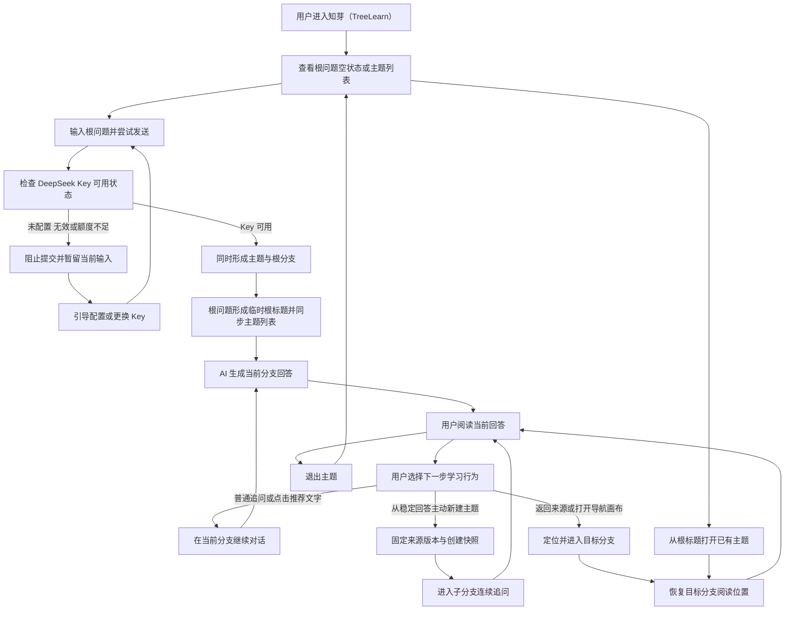
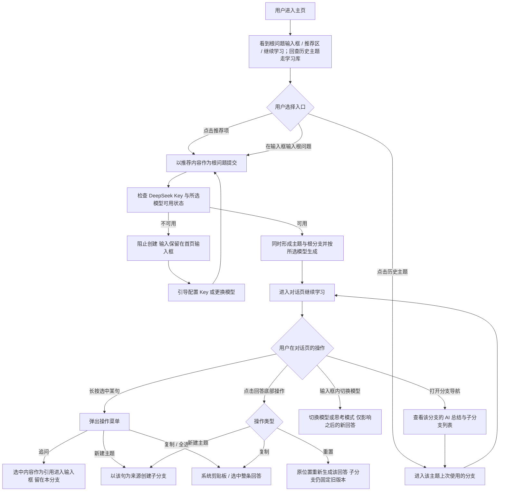

# 产品需求文档（PRD）

**文档版本**：V3.2  
**创建日期**：2026-09-22  
**需求名称**：知芽（TreeLearn）  
**创建人**：prd-write-agent  
**上游基线**：`结构化需求基准说明书_知芽（TreeLearn）_V3.0.md`（2026-09-20 边界冻结）+ `结构化需求基准说明书_知芽（TreeLearn）_V3.1增量.md` + `Docs/03-prd-draft/V3.1-知芽（TreeLearn）产品需求文档（PRD）.md`（2026-09-21 定稿，本版复制基线）

> **V3.2 变更性质说明**
>
> 本版相对 V3.1 **只改写因信息架构（IA）迁移而失效的条目**：一级入口改由底部标签栏承载（主页 / 学习库 / 设置），首页不再是唯一的入口页；主题列表与归档内容改由学习库承载；搜索的唯一入口改为学习库顶部的搜索框，归档动作仍留在分支导航屏。「单一入口页」与「不得出现第二套首页」的旧口径一并改写为「一级入口由标签栏承载、首页不重复承载主题列表」。
>
> V3.2 **不新增、不删减任何功能条目**（F01–F21 与 V3.1 完全一致），也不调整任何功能语义：归档与恢复语义、删除的整树与不可逆语义、检索的字段覆盖、生成的中断 / 重试语义与无可用 Key 守卫均原样沿用 V3.1。变更范围止于**入口与归属**，不是能力。
>
> 本版是**全量文档**：以 `Docs/03-prd-draft/V3.1-知芽（TreeLearn）产品需求文档（PRD）.md`（2026-09-21 定稿）为基线复制后改写上述条目；V3.1 作为已冻结历史版本保持内容原样。

> **V3.1 变更性质说明**
>
> 本版在 V3.0 基础上新增 **F16–F21** 六项功能，全部属于 V3.0 冻结边界**之外**的新增范围，由用户本人于 2026-09-20 至 2026-09-21 以书面指令确认纳入。
>
> 新增内容**不修改任何已冻结规则**：根标题即主题唯一身份、根分支不可归档、首次创建原子性、仅稳定回答可分叉、创建快照不可变、主题列表无独立主题名——以上不变量在 V3.1 中继续有效，新增能力仅叠加于其上。
>
> **需求基准已同步**：F16～F21 已在 V3.1 增量需求基准中登记为 BASE-21～BASE-26；V3.0 未被覆盖的冻结规则继续有效。

---

# 1. 需求背景与来源

## 1.1 业务现状与痛点

- **业务现象**：用户本人在普通 AI 聊天工具中提出 q1、阅读 a1 时产生 q2；探究 q2 及后续疑问后，a1 已位于长对话上方，用户难以回到原处继续阅读。（BASE-01）
- **核心痛点**：
  1. **用户侧**：线性会话将不同回答衍生的追问按时间混排，主问题与临时探索相互干扰，来源位置难以找回，后续回答使用的上下文不再专一。（BASE-01、BASE-02）
  2. **产品闭环侧**：若主题和根分支分别维护名称，同一棵树会出现两套显示身份；若根分支可归档，完整主题可能从日常结构中消失；若无可用 Key 时仍创建主题或根分支，主题列表会留下未真正开始的空树。（BASE-03）
- **不做 vs 做的价值对比**：

| 维度 | 不做的负面影响 | 做了之后的核心价值 |
| :--- | :--- | :--- |
| 用户侧 | 用户继续在长会话中滚动寻找原回答，或另开聊天并复述背景；原阅读位置、疑问来源和上下文边界难以保留，具体时间损失未量化。（BASE-01、BASE-02） | 用户可从稳定回答建立隔离分支，探索后回到来源位置，并通过树状结构了解真实延伸方向。（BASE-07 至 BASE-13、BASE-16） |
| 产品闭环侧 | 主题身份、根节点整理边界与首次提交状态可能相互冲突，导致树结构含义不稳定。（BASE-03） | 主题列表复用根分支标题，根分支不可归档；无可用 Key 时不产生主题或根分支，只有可用 Key 下提交根问题才形成一棵树。（BASE-05、BASE-06、BASE-14、BASE-18） |
| 业务侧 | 本项目为个人自用，无业务收益损失口径。（BASE-04） | 以功能场景验收知芽（TreeLearn）的树状分支学习闭环，不声称已有群体或商业收益。（BASE-04） |

## 1.2 需求来源

- [x] **用户反馈**：需求发起人本人描述了 q1 → a1 → q2 连续探索后难以找回 a1、上下文混杂的实际经历。（BASE-01、BASE-02）
- [ ] **数据分析**：本期无频次、耗时、群体样本或业务指标数据，不作推断。
- [ ] **战略规划**：个人自用项目，本期无商业化或组织战略目标。
- **用研状态与证据边界**：本期未执行外部用户研究，这是用户基于个人自用范围作出的明确决定；现有依据仅来自需求发起人本人的场景描述，不能将发生频率、替代方案代价或收益外推至其他职场人。（BASE-01、BASE-02、BASE-04）
- **边界冻结**：用户本人已于 2026-09-20 明确回复“确认边界冻结”，V3.0 以已冻结的需求基准为唯一需求来源。

## 1.3 V3.1 新增需求来源

V3.1 新增项来源于用户本人在 UX 高保真原型走查后提出的六条修改指令，其中五项转化为功能需求（第六项为原型信息架构问题，已在 F16 中解决）：

| 指令序号 | 用户原话摘要 | 转化功能 | 性质 |
| :--- | :--- | :--- | :--- |
| 1 | 首页增加推荐主题，结合已学内容推荐，可点击，弹幕滚动 | F17 | 新增功能 |
| 2 | 设置字太多；没有 DeepSeek 模型选择，需在问答时支持切换 | F18 | 新增功能 |
| 3 | 划词后增加复制、全选；「新建分支」文案太长要简化；新增「直接问 AI」（选中词作为引用） | F19 | 交互优化 + 新增 |
| 4 | 回答卡片底部增加复制、重置、新建分支；推荐问题参考豆包样式 | F20 | 新增功能 |
| 5 | AI 总结放到分支导航页 | F20 | 位置调整 |
| 6 | 首页没有历史主题入口和设置按钮；感觉有两个主页 | F16 | 信息架构调整 |
| 7 | DeepSeek 需要系统提示词，更好服务产品定位，让学习更高效、信息更准确、更容易懂 | F21 | AI 回答策略与调用契约 |

**参考设计来源**：指令 2、4 附带第三方产品的界面截图作为样式参考（模型切换弹层、回答操作行与推荐问题样式）。参考仅用于**交互形态与视觉层级**，不复制其品牌元素、文案或功能范围。

**参考设计带来的边界约束**：参考产品（豆包）的模型列表包含非 DeepSeek 模型，知芽 V3.1 **不采纳**——模型选择范围仍严格限定在 DeepSeek 供应商内，见 F18 与 §6.3.3。

---

# 2. 需求价值与人群分析

## 2.1 目标用户与场景（JTBD）

| 用户类型 | 优先级 | 典型角色 | 核心任务（JTBD：我要……以便……） | 核心痛点 |
| :--- | :--- | :--- | :--- | :--- |
| 核心用户 | P0 | 因工作需要持续学习陌生领域的职场人；本期实际使用者为需求发起人本人 | 当我为工作学习陌生知识时，我要从空状态提交根问题并以根标题识别主题；在阅读稳定回答时保留来源另开独立路径深入追问；探索后回到原处继续学习，并能从主题列表重新打开该树。（BASE-01、BASE-05 至 BASE-09） | 线性对话混杂主线与临时探索；来源和阅读现场难以找回；主题身份、根节点整理与首次提交缺少一致边界。（BASE-01、BASE-02、BASE-03） |
| 次要用户 | 不定义 | 本期不定义次要用户群 | 本期不承担群体推广验收，不扩展面向泛自主学习者的专属流程。（BASE-04） | 不适用 |

---

# 3. 业务目标

## 3.1 可量化核心指标

| 指标名称 | 统计口径（分子/分母） | 目标值 | 最低可接受值（底线） | 测量周期 |
| :--- | :--- | :--- | :--- | :--- |
| 业务 KPI 不适用 | 用户明确本期不设业务指标，因此无分子、分母或当前基线；不把功能测试通过率伪装成业务指标 | 本期不设 | 本期不设 | 不适用 |

## 3.2 体验目标（非量化）

- 用户能够完成“首页提交根问题 → 以根标题识别主题 → 深入分叉 → 找回来源 → 退出后重开主题”的完整链路。（BASE-05、BASE-06、BASE-07、BASE-09；F16 调整入口表述）
- 用户从 a1 创建子分支并完成探索后，能够回到 a1 离开时的位置继续阅读或提问，且父分支正常回答不受子分支内容污染。（BASE-08、BASE-09）
- 在深层级和大量同级分支中，用户仍可通过祖先路径、最近使用、更多、搜索及画布识别并找到延伸方向。（BASE-10、BASE-11）
- 功能验收不得出现主题显示身份与根标题分离、无可用 Key 后留下主题或根分支、根分支被归档、跨分支回答串扰、父分支后续内容改写出生快照、部分回答被用于分叉、失败重试重复创建消息或分支，以及未明确告知的数据丢失。（BASE-05 至 BASE-08、BASE-14、BASE-15、BASE-17 至 BASE-19）

**V3.1 新增体验目标：**

- 一级入口由底部标签栏承载（主页 / 学习库 / 设置）：主页负责“开始新建”，学习库承载主题列表与“继续历史”的回查；首页不再重复承载主题列表，也不得再出现两套品牌头部。（F16、V3.1 用户指令 6）
- 用户能从推荐区直接开始一段新的学习，点击一次即进入对话页，不被迫先二次确认。（F17、V3.1 用户指令 1）
- 用户能在提问时按任务复杂度切换模型与思考模式，入口就在输入框内，不需要离开当前上下文去设置页。（F18、V3.1 用户指令 2）
- 用户长按回答中的任意一句即可复制、追问或另开分支，从“产生疑问”到“提出追问”不需要手动复制粘贴重组内容。（F19、V3.1 用户指令 3）
- 用户在分支导航页即可判断当前分支学到了什么，从而决定进入哪个子分支，不需要先进对话再回看。（F20、V3.1 用户指令 5）
- 新增交互不得引入新的验收红线：滚动中的推荐项必须可稳定点击、长按选中必须有明确反馈、浮层菜单不得被屏幕边缘裁切、重置不得迁移已有子分支。（F17、F19、F20）
- DeepSeek 主回答默认表现为自适应学习导师：先解决当前问题，再按需补足术语、前置知识、例子和易错点；不确定或时效信息必须说明边界，最终回答在思考过程折叠时仍可独立理解。（F21、BASE-26）

---

# 4. 竞品分析

> 本次需求未执行用研环节，也未形成系统竞品分析；本章不补写竞品、竞品能力或对标结论。

## 4.1 核心对标矩阵

本期无经用研确认的对标矩阵，不填充竞品信息。

## 4.2 差异化策略

本期不基于竞品推导差异化策略。知芽（TreeLearn）的产品范围仅依据冻结需求：主题以根分支标题作为唯一显示身份，从稳定回答建立独立分支，用创建快照固定历史依据，并通过逐层导航与总览画布找回内容。（BASE-06 至 BASE-11、BASE-15）

---

# 5. 业务流程

## 5.1 核心业务流程图

流程来源：BASE-05 至 BASE-11、BASE-15、BASE-16、BASE-18。

## 5.2 关键分支与异常流向

- **首次提交原子性**：用户输入根问题并尝试发送 → Key 未配置、无效或额度不足时阻止提交，输入可暂留当前界面，但不形成主题、根分支或树节点 → Key 可用后再次提交，主题与根分支作为同一次用户结果形成。（BASE-05、BASE-18）
- **根回答失败**：主题和根分支已成功形成后，回答出现网络、超时或生成失败 → 保留主题、根问题、根分支与部分回答 → 在原位置重试，不产生第二个根分支。（BASE-05、BASE-15、BASE-18）
- **主题身份**：根问题先形成临时根标题 → AI 仅依据根问题生成一次正式根标题 → 主题列表始终复用根标题；手动修改或主动刷新根标题后同步更新列表。（BASE-06）
- **当前分支继续**：用户普通追问，或点击推荐问题文字 → 问题直接作为当前分支追问发出，不进入输入框等待编辑，不增加树节点。（BASE-07、BASE-16）
- **主动分叉**：用户从稳定回答的选中文字、整条回答或推荐问题旁的新建主题入口发起 → 固定当前稳定回答版本并创建子分支；推荐问题的分叉入口直接以该问题作为子分支首个问题发出，不停留在待编辑的来源态。（BASE-07、BASE-15、BASE-16）
- **部分回答限制**：回答生成中或失败并保留部分内容 → 内容可阅读但不可作为新分支来源 → 原位重试成功成为稳定回答后方可分叉。（BASE-15）
- **查找与返回**：用户通过祖先路径、最近使用、更多、搜索或画布定位节点 → 进入目标分支并恢复阅读位置。（BASE-09、BASE-10、BASE-11）
- **归档与恢复**：根分支和完整主题不提供归档；非根父分支归档后，其完整子树从日常导航和默认画布隐藏，并可从已归档入口或搜索整体恢复。（BASE-14）
- **永久删除**：永久删除非根父分支前提示受影响的子树数量；删除根分支按删除整个主题处理，完整主题仅可保留或经确认永久删除。（BASE-05、BASE-14）

## 5.3 V3.1 新增流程

流程来源：V3.1 用户指令 1–6；其中 Key 守卫、稳定回答分叉、原位置重试、子分支版本固定等环节沿用 BASE-05、BASE-07、BASE-15、BASE-18。

**V3.1 新增流程要点**：

- **推荐直达**：点击推荐项即视为提交根问题，与手动输入共用同一套 Key 守卫与首次创建原子性规则，不新增第二条创建路径。（BASE-05、V3.1 用户指令 1）
- **模型切换时机**：模型与思考模式在发送前确定，作用于该次及之后的生成；已生成回答不被追溯改写。（BASE-07、V3.1 用户指令 2）
- **划词双出口**：长按后的追问留在当前分支，新建主题才改变树结构；二者共享同一选中内容，但产生完全不同的结构结果。（BASE-07、V3.1 用户指令 3）
- **重置不回流**：重置只替换被操作的那条回答，不触发子分支迁移，也不改变父分支其他内容。（BASE-07、V3.1 用户指令 4）

---

# 6. 需求规格（核心章节）

## 6.1 功能清单总览

| 功能编号 | 功能名称 | 优先级 | 简要描述 | 来源编号 |
| :--- | :--- | :--- | :--- | :--- |
| F01 | 多主题生命周期与首次创建原子性 | 【P0】 | 覆盖根问题空状态、Key 前置拦截、主题与根分支同时形成、退出重开和整题删除 | BASE-05、BASE-18 |
| F02 | 主题显示身份与根标题 | 【P0】 | 主题列表复用根分支标题，不维护独立主题名 | BASE-06、BASE-19 |
| F03 | 独立对话树与稳定来源 | 【P0】 | 以稳定回答版本为分叉来源，形成可持续深入的真实对话树 | BASE-07、BASE-15 |
| F04 | 分层上下文与创建快照 | 【P0】 | 固定分支出生背景，隔离兄弟、后代及父分支后续内容 | BASE-08、BASE-19 |
| F05 | 聚焦阅读与现场恢复 | 【P0】 | 只阅读当前分支，并恢复离开位置与来源锚点 | BASE-09 |
| F06 | 移动端逐层导航 | 【P0】 | 用祖先路径、当前节点、直接子节点、最近使用、更多和搜索定位分支 | BASE-10 |
| F07 | 树状总览画布 | 【P0】 | 以一个分支一段枝、**枝长随该分支对话轮数增长**的植物形态呈现父子关系、标题与状态 | BASE-11 |
| F08 | 非根分支标题、摘要与搜索 | 【P0】 | 非根标题稳定可控，所有分支摘要动态更新，并检索日常及已归档内容 | BASE-12、BASE-19 |
| F09 | 未读状态 | 【P0】 | 用分支蓝点和折叠祖先汇总提示未读回答 | BASE-13 |
| F10 | 非根子树归档与永久删除 | 【P0】 | 根和完整主题不可归档，非根子树整体隐藏、恢复或删除 | BASE-14、BASE-05 |
| F11 | 回答生成状态与分叉资格 | 【P0】 | 部分回答只读不可分叉，稳定版本才可作为来源 | BASE-15 |
| F12 | 结合树轮廓的推荐问题 | 【P0】 | 推荐识别已探索方向，并支持当前追问或从稳定回答分叉 | BASE-16、BASE-15 |
| F13 | 本机个人数据与 DeepSeek 配置 | 【P0】 | Android 个人自用，主题和 Key 全部仅本机保存 | BASE-17 |
| F14 | AI 与网络失败可恢复 | 【P0】 | 区分首次根问题与既有主题，在 Key、网络或回答失败时保留正确状态 | BASE-18、BASE-05、BASE-15 |
| F15 | AI 辅助生成降级 | 【P0】 | 标题、摘要或上下文压缩失败时保留已有可用内容 | BASE-19、BASE-06、BASE-12 |

### V3.1 新增功能（BASE-21～BASE-26）

| 功能编号 | 功能名称 | 优先级 | 简要描述 | 来源编号 |
| :--- | :--- | :--- | :--- | :--- |
| F16 | 首页信息架构统一 | 【P0】 | 一级导航由底部标签栏承载，首页不重复承载主题列表，消除双主页割裂 | BASE-21 |
| F17 | AI 推荐学习主题 | 【P0】 | 依据已学内容生成推荐主题，弹幕滚动展示，点击直接创建主题并开始对话 | BASE-22 |
| F18 | DeepSeek 模型选择与思考模式 | 【P0】 | 用户自选 DeepSeek 模型与思考模式；推理内容默认折叠展示、持久化并进入后续上下文 | BASE-23 |
| F19 | 划词操作集与引用追问 | 【P0】 | 长按选中回答文字后提供追问、新建主题、复制、全选四项操作 | BASE-24 |
| F20 | 回答内容级操作与 AI 总结 | 【P0】 | 回答底部提供复制、重置、新建主题、子分支列表；AI 总结置于分支导航页 | BASE-25 |
| F21 | DeepSeek 自适应学习导师提示词 | 【P0】 | 主回答使用版本化 system 提示词，准确性优先并自适应解释；派生 AI 调用按用途隔离 | BASE-26 |

## 6.2 功能详细规格

### 6.2.1 【P0】多主题生命周期与首次创建原子性

来源依据：BASE-05、BASE-14、BASE-15、BASE-18

#### 场景价值

帮助用户从空白应用建立第一棵学习树，并确保无可用 Key 时不会留下未真正开始的主题或根分支。

#### 场景示例

1. 用户首次进入知芽（TreeLearn），在无主题的空状态输入根问题并尝试发送。
2. Key 可用时，主题与根分支同时形成；用户随后可创建第二个主题并从主题列表切换打开。
3. 用户退出后重新打开已有主题，回到上次使用的分支和阅读状态；不再需要的主题可经确认永久删除。

#### 功能规格

1. 首版支持多个本机学习主题，不设置未经确认的固定主题数量上限。（BASE-05）
2. 首次没有主题时，展示可输入根问题的空状态。（BASE-05）
3. 用户尝试发送根问题时，先根据 DeepSeek API Key 是否已配置、有效且额度充足决定是否提交。（BASE-05、BASE-18）
4. Key 未配置、无效或额度不足时，阻止发送；根问题输入可暂时保留在当前界面，但不提交主题、根分支或任何树节点。（BASE-05、BASE-18）
5. Key 可用且根问题成功提交后，主题与根分支作为同一次用户结果形成；一棵主题树以该根分支为起点。（BASE-05）
6. 主题列表用于打开已有主题；用户退出后再次打开某主题时，回到该主题上次使用的分支和阅读状态。（BASE-05）
7. 用户可经确认永久删除整个主题；删除后该主题的全部分支和本机数据不可恢复。（BASE-05）
8. 删除根分支等同于删除整个主题，不保留没有根分支的主题空壳。（BASE-05、BASE-14）

#### 异常情况

1. 若 Key 未配置、无效或额度不足，则只保留当前界面的根问题输入并引导配置或更换 Key，不增加主题或根分支。（BASE-05、BASE-18）
2. 若主题和根分支已成功形成后出现网络、超时或回答生成失败，则保留主题、根问题和根分支；原位重试不得产生第二个根分支。（BASE-05、BASE-15、BASE-18）
3. 若用户取消整个主题的永久删除确认，则主题及其全部本机数据保持不变。（BASE-05）

### 6.2.2 【P0】主题显示身份与根标题

来源依据：BASE-06、BASE-19

#### 场景价值

通过让根分支标题同时承担主题显示身份，帮助用户始终用同一个名称识别一棵树，避免主题名与根标题不一致。

#### 场景示例

1. 用户提交根问题后，根问题形成根分支临时标题，主题列表立即显示同一标题。
2. AI 仅依据根问题生成一次正式根标题，主题列表同步显示生成结果。
3. 用户手动修改或主动刷新根标题，主题列表与根分支同时显示更新后的同一标题。

#### 功能规格

1. 主题列表直接复用根分支标题；不设置独立主题名或第二套主题命名状态。（BASE-06）
2. 根分支临时标题来自根问题。（BASE-06）
3. AI 正式根标题仅依据根问题生成一次，不读取后续对话或其他分支内容作为命名依据。（BASE-06）
4. 根标题不随根分支后续对话或摘要更新自动变化。（BASE-06）
5. 用户可手动修改根标题；修改结果同时成为主题列表的显示标题。（BASE-06）
6. 用户可主动刷新根标题；刷新仍只依据根问题生成，成功后主题列表与根分支同步更新。（BASE-06）

#### 异常情况

1. 若首次 AI 根标题命名失败，则保留由根问题形成的临时标题，主题列表继续显示同一标题。（BASE-06、BASE-19）
2. 若主动刷新根标题失败，则保留原根标题，主题列表不被失败结果覆盖。（BASE-06、BASE-19）
3. 若用户继续对话或摘要自动更新，则根标题和主题列表标题均不自动变化。（BASE-06）

### 6.2.3 【P0】独立对话树与稳定来源

来源依据：BASE-07、BASE-15、BASE-18

#### 场景价值

帮助用户将阅读中产生的新疑问放入独立探索路径，同时用稳定回答版本固定分支的历史来源，避免后续变化改写既有关系。

#### 场景示例

1. 用户在当前分支阅读一条稳定 AI 回答，并选中其中一段文字。
2. 用户围绕所选文字主动创建子分支，在子分支内连续追问。
3. 用户从同一稳定回答创建其他兄弟分支，或在任一分支继续创建更深层子分支。

#### 功能规格

1. 一个学习主题对应一棵对话树，一个树节点对应一条可连续追问的独立对话分支。（BASE-07）
2. 普通追问留在当前分支，只有用户主动新建主题才增加节点。（BASE-07）
3. 树的逻辑深度不设产品层级限制；同一稳定回答可创建多个兄弟分支，任一分支可继续深层分叉。（BASE-07）
4. 用户可从稳定 AI 回答中选中的文字或整条回答创建子分支；分叉固定来源消息、稳定回答版本及对应的选中文字或整条回答。（BASE-07、BASE-15）
5. 来源回答之后被重生成时，已有子分支继续关联创建时的旧稳定回答版本，不自动迁移到新版本。（BASE-07）

#### 异常情况

1. 若回答仍在生成或生成失败并只保留部分内容，则该部分回答不可被选择为新分支来源。（BASE-15）
2. 若用户尝试创建分支时 Key 未配置、无效或额度不足，则保留当前输入但不新增已提交消息或分支，并引导配置或更换 Key。（BASE-18）
3. 若分支创建后的回答生成失败，则保留已创建的分支、来源关系和用户问题；原位重试不得重复创建分支。（BASE-15、BASE-18）
4. 若父分支后来新增内容或重生成来源回答，则既有子分支仍使用创建时的稳定版本，不自动迁移或改写。（BASE-07）

### 6.2.4 【P0】分层上下文与创建快照

来源依据：BASE-08、BASE-19

#### 场景价值

通过固定每个子分支创建时的背景并隔离其他路径，帮助用户持续深入同一问题而不被兄弟分支或父分支后续内容污染。

#### 场景示例

1. 用户从父分支的稳定回答创建子分支，保留来源版本、锚定内容和当时的上游背景。
2. 用户在子分支继续多轮追问，同时父分支也继续产生新内容。
3. 用户再次进入子分支时，AI 仍依据该分支创建时的上游背景和本分支对话回答。

#### 功能规格

1. 子分支保存创建时的来源稳定回答版本、该版本的思考内容与最终回答、锚定内容、上游背景和阅读位置，形成不被父分支后续内容改写的创建快照。（BASE-08、BASE-23）
2. 当前分支的正常 AI 回答只使用本分支对话及出生时的上游快照；开启思考模式所得的历史思考内容按 BASE-23 进入后续上下文。（BASE-08、BASE-23）
3. 正常回答所需的近期内容保留原文，较早内容使用摘要；具体原文长度、摘要长度和切换阈值不在本期固定。（BASE-08）
4. 正常回答不读取兄弟分支、子分支或父分支在当前分支创建后新增的内容。（BASE-08）

#### 异常情况

1. 若父分支继续对话或重生成来源回答，则既有子分支的创建快照保持不变。（BASE-08）
2. 若上下文压缩失败，则暂停本次回答并提示用户重试，不得静默丢弃上游背景后继续回答。（BASE-19）
3. 若其他分支存在相关内容，则不得将其自动带入当前分支正常回答。（BASE-08）

### 6.2.5 【P0】聚焦阅读与现场恢复

来源依据：BASE-07、BASE-08、BASE-09、BASE-13

#### 场景价值

帮助用户在长回答和多层探索之间切换后准确回到原阅读现场，减少重新滚动和寻找来源带来的学习中断。

#### 场景示例

1. 用户在父分支长回答的中间位置，从稳定回答创建子分支。
2. 用户在子分支完成多轮追问后返回父分支。
3. 用户回到离开时的阅读位置，并定位到触发分支的选中文字或整条来源回答。

#### 功能规格

1. 阅读区域只展示当前分支的连续对话，不混入其他分支消息。（BASE-09）
2. 用户离开某条分支时保存该分支的阅读位置，再次进入时恢复至该位置。（BASE-09）
3. 用户从子分支返回来源分支时，定位到产生该分支的选中文字；未选中文字时定位到作为来源的整条稳定回答。（BASE-09）
4. 来源回答保留创建分支时的稳定版本关系，使用户能够追溯分支从何处产生。（BASE-07、BASE-08、BASE-09）

#### 异常情况

1. 若来源回答之后被重生成，则返回既有子分支来源时仍定位创建时的旧稳定回答版本，不迁移至新回答。（BASE-07、BASE-09）
2. 若用户离开时回答仍在生成，则保存离开时的阅读位置；未读状态按未读规则处理，不因位置恢复而提前清除。（BASE-09、BASE-13）

> 口径注记（不改以上规格条款本身）：父分支出生上下文属子分支自身：子分支展示其出生快照内的上游对话不属『混入其他分支消息』；禁止的是同级分支与后代分支的消息进入阅读区（2026-09-22 用户裁决）。

### 6.2.6 【P0】移动端逐层导航

来源依据：BASE-10、BASE-12、BASE-13、BASE-14

#### 场景价值

帮助用户在移动端深层级或大量同级分支中辨认当前位置并找到目标分支，无需依赖持续向右缩进的完整树。

#### 场景示例

1. 用户从当前分支打开逐层导航，查看祖先路径、当前分支和直接子分支。
2. 用户在直接子分支较多时先查看最近使用，目标未出现时打开更多或发起搜索。
3. 用户点击目标节点直接进入对应对话，并恢复该分支上次阅读位置。

#### 功能规格

1. 逐层导航展示当前分支的祖先路径、当前分支和直接子分支；点击可进入的节点后直接打开其对话。（BASE-10）
2. 当直接子分支较多时，使用最近使用、更多和搜索帮助定位，不要求一次展示全部子分支。（BASE-10）
3. 深层级导航通过逐层进入及祖先路径返回，不依赖持续增加横向缩进。（BASE-10）
4. 分支折叠状态按学习主题保存在本机，用户再次进入主题时沿用该主题的折叠状态。（BASE-10）
5. 分支结构忠实呈现实际对话关系，不使用自动语义分组；同级分支查找使用最近使用、更多和搜索。（BASE-10）
6. 导航中的目标分支及折叠祖先按未读规则显示未读状态，未读后代不会因折叠而被隐藏。（BASE-13）
7. 已归档非根子树不出现在日常逐层导航，可经已归档入口或搜索找到。（BASE-14）

#### 异常情况

1. 若当前节点层级很深，则通过祖先路径逐级返回或直接进入任一祖先节点，不增加持续横向缩进。（BASE-10）
2. 若直接子分支无法一次展示，则保留最近使用项，并由更多与搜索承载其余分支。（BASE-10）
3. 若未读分支位于折叠层级内，则折叠祖先继续显示后代未读汇总，直至对应未读被实际阅读。（BASE-13）
4. 若目标分支已归档，则日常导航不展示该节点，搜索结果标明其归档状态。（BASE-12、BASE-14）

### 6.2.7 【P0】树状总览画布

来源依据：BASE-11、BASE-12、BASE-13、BASE-14

#### 场景价值

通过可缩放的树状总览呈现真实学习路径，帮助用户从全局理解已经向哪些方向延伸，并跨分支定位内容。

#### 场景示例

1. 用户进入总览画布，查看当前学习主题的真实父子关系。
2. 用户平移、缩放或折叠子树，通过标题、摘要和状态定位目标节点。
3. 用户选中节点查看完整摘要、来源回答和锚定原文，再选择进入对应对话。

#### 功能规格

1. 提供总览入口，画布以自动树布局展示学习主题中由实际对话产生的父子关系。（BASE-11）
2. 每个节点包含分支名称和本分支摘要，并显示未读、子分支数量与折叠状态；画布缩小时可只显示标题。（BASE-11）
3. 画布支持平移、缩放、折叠子树、搜索定位和回到当前分支。（BASE-11）
4. **一个分支就是一段枝**：每个分支在画布上是一段带锥度的枝（根部粗、末梢细；粗细随这段枝下面挂着的叶子数递减），根分支是主干、位于画布底部，子分支从父枝上抽出并向上生长。此隐喻不改变 BASE-11 要求的自动布局、真实父子关系与节点信息内容。（V3.1 用户指令；2026-09-20 UX 复核新增）
5. **枝段长度 = 该分支的对话轮数**：某分支里聊过的轮数越多，这一段枝越长（基础长度 + 每轮增量，并设上限）。因此同一话题聊得越久，整棵树越高；而轮数本身**不会**让树上多出侧枝——侧枝只能由用户主动新建子分支产生。（2026-09-20 UX 复核新增）
6. **枝干与叶子由「有没有子分支」决定**：没有子分支的枝在末梢抽出一片叶子，表示这是探索前沿；长出子分支后它不再显示叶子、末梢变为木节（表示已木质化成枝干），新子分支成为新的叶子。叶子上的露珠表示该分支有未读；折叠后该枝收成一颗芽并标出被收起的分支数。（2026-09-20 UX 复核新增）
7. 画布提供**适应屏幕**操作：把整棵树的水平与垂直范围收进视野，采用**底部对齐**——根贴着画布下缘、上方留出后续生长空间，而非垂直居中。（V3.1 用户指令；2026-09-20 UX 复核新增）
8. 画布底部使用极淡的土地暗部作为背景暗示，不引入可交互元素，不改变任何节点的可读性。（2026-09-20 UX 复核新增）
9. **标题随缩放分层**：远景（缩小到一定比例以下）只显示树形与当前分支，标题全部隐去；中景显示叶子标题牌与当前路径上的枝干标题牌；近景时叶子额外显示摘要首行。**叶子的标题牌统一排在树冠上方的标题栏里（可多行，每块用一根细引线垂到自己的叶子），不得互相重叠，也不得遮挡任何一片叶子**；标题栏排不下时该叶子只保留叶形，点叶子仍可查看标题。完整摘要在任意层级都由选中节点查看。（BASE-11）
10. **点选节点弹出跟手小卡片**：显示节点角色（叶子 / 枝干）、标题、摘要与来源，并提供「进去聊」与「折叠 / 展开子树」；卡片贴着被点节点弹出、空间不足自动翻转、始终完整落在屏幕内。拖动或缩放画布时收起该卡片。（2026-09-20 UX 复核新增）
11. 用户选中节点后可查看完整摘要、来源回答和锚定原文，并可选择进入该分支对话。（BASE-11）
12. 节点不支持自由摆放；画布保持自动树布局。（BASE-11）
13. 新增分支或摘要变化后，画布应尽量保持用户当前视野和所选节点的位置稳定。（BASE-11）
14. 子树折叠后，折叠节点继续显示后代数量和未读汇总。（BASE-11、BASE-13）
15. 已归档非根子树不出现在默认画布，可经已归档入口或搜索找到。（BASE-14）

#### 异常情况

1. 若缩放后的空间不足以容纳摘要，则节点只显示标题；用户可放大或选中节点查看完整摘要。（BASE-11）
2. 若子树已折叠，则隐藏其后代节点，但保留后代数量和未读汇总。（BASE-11、BASE-13）
3. 若新增分支或摘要更新引发布局变化，则尽量维持当前视野和所选节点位置。（BASE-11）
4. 若目标节点属于已归档非根子树，则默认画布不展示；用户从已归档入口或搜索进入对应归档内容。（BASE-14）

### 6.2.8 【P0】非根分支标题、摘要与搜索

来源依据：BASE-06、BASE-12、BASE-14、BASE-19

#### 场景价值

帮助用户用稳定名称识别非根分支，通过动态摘要判断所有分支的学习方向，并从日常或已归档内容中找到目标路径。

#### 场景示例

1. 用户创建非根分支后先看到由首问形成的临时标题，随后获得一次 AI 命名结果。
2. 用户在分支内继续多轮对话，标题保持不变，摘要随本分支内容更新。
3. 用户通过标题、问题、回答或锚定原文搜索目标分支，并根据祖先路径与归档状态进入正确结果。

#### 功能规格

1. 非根分支创建时由首问形成临时标题，AI 再结合来源锚点与首问命名一次。（BASE-12）
2. 非根分支标题不随后续对话自动变化；用户可手动修改，也可主动刷新生成新标题。（BASE-12）
3. 根分支标题遵循主题显示身份规则，不使用非根分支的“来源锚点与首问”命名方式。（BASE-06、BASE-12）
4. 所有分支摘要随本分支实际对话自动更新，只总结本分支内容，不吸收其他分支内容。（BASE-12）
5. 搜索范围覆盖主题所复用的根标题、其他分支标题、用户问题、稳定或部分 AI 回答、已持久化的思考内容及锚定原文。（BASE-12、BASE-23）
6. 每条搜索结果显示祖先路径及归档状态，支持定位日常分支和已归档非根子树中的分支。（BASE-12、BASE-14）
7. **无摘要时不显示占位文案**：摘要尚未生成或为空时，画布节点、节点详情、主题卡、分支导航与分支行等所有摘要展示位一律不渲染该行，不得出现「摘要将随本分支对话自动更新」这类解释性占位文案；摘要为空只是少一行信息，不需要向用户解释。（BASE-12；2026-09-20 UX 复核新增）

#### 异常情况

1. 若非根分支首次 AI 命名失败，则保留由首问形成的临时标题。（BASE-12、BASE-19）
2. 若用户主动刷新非根标题时生成失败，则保留刷新前的原标题，不以失败结果覆盖。（BASE-12、BASE-19）
3. 若摘要生成失败，则保留旧摘要，且失败不影响用户继续聊天。（BASE-12、BASE-19）
4. 若搜索结果属于已归档非根子树，则明确显示归档状态，避免与日常分支混淆。（BASE-12、BASE-14）

### 6.2.9 【P0】未读状态

来源依据：BASE-13

#### 场景价值

帮助用户在离开生成中的分支后识别哪些方向出现了尚未看到的新回答，并在折叠结构中追踪未读来源。

#### 场景示例

1. 用户在 AI 仍在生成回答时离开当前分支。
2. 回答完成后，该分支显示实心蓝点，其折叠祖先显示后代未读汇总。
3. 用户进入该分支并让最新未读回答进入可视区域后，未读状态清除。

#### 功能规格

1. 只有分支产生了用户尚未看到的 AI 回答时，才在该分支显示实心蓝点。（BASE-13）
2. 当未读分支位于折叠子树内时，其折叠祖先显示后代未读汇总，未读提醒不因折叠而消失。（BASE-13）
3. 用户打开分支且最新未读回答实际进入可视区域后，清除该分支对应的未读状态。（BASE-13）
4. 推荐问题不计入未读，不因推荐内容出现或更新而显示蓝点。（BASE-13）

#### 异常情况

1. 若用户只是进入分支但最新未读回答尚未进入可视区域，则保留未读状态。（BASE-13）
2. 若未读分支所在子树被折叠，则在折叠祖先保留后代未读汇总；展开后逐层定位未读分支。（BASE-13）
3. 若出现的是推荐问题而非 AI 回答，则不创建未读状态。（BASE-13）

### 6.2.10 【P0】非根子树归档与永久删除

来源依据：BASE-05、BASE-12、BASE-14

#### 场景价值

帮助用户整理不再需要频繁查看的非根探索路径，同时保护根分支和完整主题始终可见，并让归档或删除保持真实父子关系。

#### 场景示例

1. 用户查看根分支操作时没有归档能力，完整主题继续保留在主题列表。
2. 用户归档一个包含后代的非根父分支，该分支与完整子树从日常导航和默认画布中隐藏。
3. 用户从已归档入口或搜索整体恢复该子树，或经确认永久删除目标非根父分支及全部后代。

#### 功能规格

1. 根分支不允许归档，首版不提供隐藏完整主题的能力。（BASE-14）
2. 完整主题在主题列表中只能保留，或经确认永久删除；主题列表不提供主题归档或隐藏。（BASE-14）
3. 仅非根分支可归档；归档非根父分支时，其整棵子树作为一个单元从日常逐层导航和默认画布中隐藏。（BASE-14）
4. 已归档非根子树可经已归档入口或搜索找到，并以整棵子树为单位恢复。（BASE-12、BASE-14）
5. 归档或恢复过程中，不将任何后代重接到其他父节点。（BASE-14）
6. 永久删除非根父分支前，必须说明受影响的子树数量并要求用户确认。（BASE-14）
7. 用户确认后，永久删除该非根父分支及全部后代，不允许删除中间节点后自动重接后代。（BASE-14）
8. 删除根分支按删除整个主题处理；确认后主题全部分支和本机数据不可恢复。（BASE-05、BASE-14）

#### 异常情况

1. 若用户在根分支或主题列表尝试寻找归档能力，则不提供可执行的根分支归档或主题隐藏行为。（BASE-14）
2. 若用户取消永久删除确认，则不删除任何节点，原有树结构保持不变。（BASE-14）
3. 若待删除非根父分支包含后代，则不得只删除中间节点或自动重接后代；必须按已提示范围处理整棵子树。（BASE-14）
4. 若待删除节点是根分支，则按整个主题删除处理，不保留主题空壳。（BASE-05、BASE-14）

### 6.2.11 【P0】回答生成状态与分叉资格

来源依据：BASE-07、BASE-15

#### 场景价值

通过区分生成中、失败部分回答与稳定回答，帮助用户保留可阅读内容，同时防止不完整版本成为新分支的历史依据。

#### 场景示例

1. 用户发送问题后查看生成中的部分回答，此时可以阅读但不能从中创建分支。
2. 生成失败后，用户保留已产生的部分回答并在原位置手动重试。
3. 重试成功形成稳定回答后，用户才可选中文字或针对整条回答创建子分支。

#### 功能规格

1. 回答生成未完成或失败时，已产生的部分思考内容和部分回答均保留并可阅读。（BASE-15、BASE-23）
2. 生成中或失败的部分回答不可被选择为新分支来源，不提供可执行的选中文字或整条回答分叉行为。（BASE-15）
3. 用户可在失败发生的原位置手动重试；重试不得重复创建用户消息或分支，也不得覆盖被历史来源引用的旧稳定版本。（BASE-07、BASE-15、BASE-23）
4. 只有重试成功后的稳定回答版本可供用户选中文字或针对整条回答创建分支。（BASE-15）
5. 已有稳定回答及其既有子分支继续固定到创建时的稳定版本，不受后续重试或重生成影响。（BASE-07、BASE-15）

#### 异常情况

1. 若回答仍在生成，则保留当前可见的部分内容，但分叉能力保持不可用。（BASE-15）
2. 若生成失败，则保留部分回答供阅读并提供原位手动重试，且不得新增重复用户消息或分支。（BASE-15）
3. 若重试仍未成功形成稳定回答，则继续保持不可分叉状态。（BASE-15）
4. 若重试成功形成稳定回答，则该稳定版本获得分叉资格；此前的部分回答不单独成为来源版本。（BASE-15）

### 6.2.12 【P0】结合树轮廓的推荐问题

来源依据：BASE-07、BASE-08、BASE-15、BASE-16

#### 场景价值

通过参考已探索方向生成后续问题，帮助用户减少重复探索，同时保持正常回答严格使用当前分支允许的上下文。

#### 场景示例

1. 用户读完当前分支的稳定 AI 回答，查看结合当前回答与主题树轮廓生成的推荐问题。
2. 用户点击推荐问题文字，该问题立刻作为当前分支的下一条追问发出，无需再编辑或二次确认。
3. 用户点击推荐问题旁的新建主题入口，该问题立刻成为新子分支的第一个问题并开始生成回答，无需再编辑或二次确认。

#### 功能规格

1. 推荐问题可参考当前回答和整棵主题树的结构化轮廓，包括已探索的分支标题、来源锚点和简短摘要，以减少重复推荐。（BASE-16）
2. 推荐过程不把其他分支完整对话带入当前分支的正常 AI 回答。（BASE-08、BASE-16）
3. 用户点击推荐问题文字时，该问题作为当前分支的普通追问直接发出，不创建新分支，也不在输入框中留下草稿。（BASE-16）
4. 用户点击推荐问题旁的新建主题入口时，以当前稳定回答的具体版本为来源创建子分支，该推荐问题同时作为子分支的第一个问题发出，并按创建快照规则保存其上下文。（BASE-08、BASE-15、BASE-16）
5. 推荐问题自身不产生树节点，只有用户主动选择新建主题时才改变树结构。（BASE-07、BASE-16）
6. 两条入口均为直达：推荐问题不经过输入框等待用户编辑，用户若想改写问题，应自行在输入框输入而非点击推荐问题。（BASE-16）
7. **推荐问题只出现在当前分支的最新回答上**：一旦用户在该分支里继续追问，新问题与其回答成为新的前沿，前一条回答立即隐藏推荐问题（无论它此前是否展示过）。推荐问题的语义是「接下来可以从这里往哪走」，只有最后那条回答才代表当前位置。（BASE-16；2026-09-20 UX 复核新增）

#### 异常情况

1. 若当前回答处于生成中或失败部分状态，则不提供可执行的新建主题行为。（BASE-15、BASE-16）
2. 若用户点击推荐问题文字，则不得误创建分支；若点击旁侧新建主题入口，则仅可从当前稳定回答创建子分支。（BASE-15、BASE-16）
3. 若树中已有相关探索方向，则该信息仅用于推荐去重，不得因此将对应分支完整内容带入正常回答。（BASE-08、BASE-16）

### 6.2.13 【P0】本机个人数据与 DeepSeek 配置

来源依据：BASE-05、BASE-06、BASE-17、BASE-18

#### 场景价值

通过个人本机使用与用户自配 AI 凭证，使多个主题的树状学习在明确数据边界内运行，不引入账号、同步或共享流程。

#### 场景示例

1. 用户首次发送根问题前进入配置入口，填写自己的 DeepSeek API Key。
2. 用户创建多个学习主题并持续对话，主题列表、树结构及学习记录保存在本机。
3. 用户需要时查看 Key 的掩码状态，并可替换或删除 Key。

#### 功能规格

1. 首版产品形态仅为 Android 移动 App，面向个人本机使用。（BASE-17）
2. 首版不提供登录、跨设备、云同步、共享或备份能力。（BASE-17）
3. 主题列表、主题树、消息及其状态、回答版本、思考内容、创建快照、标题、摘要、未读、阅读位置和 API Key 全部仅保存在本机。（BASE-17、BASE-23）
4. 本机业务数据不维护独立主题名，主题列表显示根分支标题。（BASE-06、BASE-17）
5. 首版 AI 能力仅支持 DeepSeek，用户自行配置可用且有额度的 DeepSeek API Key。（BASE-17）
6. API Key 在界面中以掩码展示，并支持用户替换和删除。（BASE-17）
7. 用户卸载应用或清除应用数据后，本机保存的主题、学习记录和配置不可恢复。（BASE-17）

#### 异常情况

1. 若用户未配置 API Key，则阻止发送，并引导用户进入配置；首次根问题不形成主题或根分支。（BASE-05、BASE-18）
2. 若 API Key 无效或额度不足，则阻止发送，并引导用户配置或更换 Key；首次根问题不形成主题或根分支。（BASE-05、BASE-18）
3. 若用户卸载应用或清除应用数据，则既有本机数据不可恢复；本期不提供云端或跨设备恢复方式。（BASE-17）

### 6.2.14 【P0】AI 与网络失败可恢复

来源依据：BASE-05、BASE-15、BASE-17、BASE-18

#### 场景价值

帮助用户在 AI 凭证、网络或回答生成失败时保住正确的输入与学习结构，并避免未提交根问题形成空树或原位重试产生重复记录。

#### 场景示例

1. 用户在空状态输入根问题，但因 Key 不可用被阻止；输入暂留当前界面，主题列表不增加记录。
2. 用户配置可用 Key 后成功提交，形成一个主题和一个根分支；后续回答生成失败时保留已提交结构和部分回答。
3. 用户在已有主题内遇到发送或生成失败，按当前状态配置 Key 或原位重试，既有树不受损且不重复创建内容。

#### 功能规格

1. Key 未配置、无效或额度不足时阻止发送，并引导用户配置或更换。（BASE-18）
2. 对首次根问题，Key 不可用时只暂留当前界面输入，不提交主题、根分支或已提交根消息。（BASE-05、BASE-18）
3. 对既有主题内的提问，Key 不可用时保留用户当前输入，但不新增已提交消息或分支，既有主题树保持不变。（BASE-18）
4. 已成功提交问题后出现断网、超时或回答生成失败时，保留用户问题、分支结构、来源锚点、已产生的部分思考内容和部分回答。（BASE-18、BASE-23）
5. 用户可按回答生成状态规则在失败发生的原位置手动重试。（BASE-15、BASE-18）
6. 原位重试不得重复创建用户消息、根分支或子分支。（BASE-05、BASE-15、BASE-18）
7. 失败后保留的部分回答可阅读但不可分叉；只有重试成功后的稳定回答版本可作为分支来源。（BASE-15、BASE-18）

#### 异常情况

1. 若首次根问题发送前发现 Key 未配置、无效或额度不足，则阻止提交、暂留输入并引导处理 Key，不增加主题、根分支或树节点。（BASE-05、BASE-18）
2. 若既有主题内的提问因 Key 不可用被阻止，则保留当前输入但不新增已提交消息或分支，既有树内容不受影响。（BASE-18）
3. 若已提交问题后断网、超时或回答生成失败，则保留问题、结构、来源及部分回答，并在原位置提供手动重试。（BASE-15、BASE-18）
4. 若用户原位重试，则沿用现有用户消息与分支，不重复创建根分支、子分支或用户消息。（BASE-05、BASE-15、BASE-18）

### 6.2.15 【P0】AI 辅助生成降级

来源依据：BASE-06、BASE-12、BASE-19

#### 场景价值

帮助用户在根或非根标题、摘要或上下文处理失败时保留已有可用内容，避免辅助能力失败破坏主题身份或悄悄削弱回答背景。

#### 场景示例

1. 用户提交根问题后 AI 根标题命名失败，继续使用根问题形成的临时标题，主题列表显示保持一致。
2. 用户创建非根分支时命名失败，继续使用首问形成的临时标题；摘要更新失败时仍保留旧摘要。
3. 上下文压缩失败时，本次回答暂停，用户在原位置重试。

#### 功能规格

1. 根标题命名失败时保留由根问题形成的临时标题；主动刷新失败时保留旧根标题，主题列表始终与根标题一致。（BASE-06、BASE-19）
2. 非根标题命名失败时保留由首问形成的临时标题；主动刷新失败时保留旧标题。（BASE-12、BASE-19）
3. 分支摘要生成失败时保留旧摘要，不以空值或失败结果覆盖。（BASE-12、BASE-19）
4. 上下文压缩失败时暂停本次回答并提示用户重试，不得静默丢失上游背景后继续生成。（BASE-19）
5. 标题或摘要失败不改变已有对话、分支结构和稳定回答状态。（BASE-19）

#### 异常情况

1. 若根标题首次生成或主动刷新失败，则保留原有可用根标题，主题列表同步保留相同标题。（BASE-06、BASE-19）
2. 若非根标题首次生成或主动刷新失败，则保留临时或旧标题，不以失败结果覆盖。（BASE-12、BASE-19）
3. 若摘要更新失败，则保留旧摘要，不阻断对话。（BASE-12、BASE-19）
4. 若上下文压缩失败，则暂停本次回答并明确提示重试，不得改用缺失上游背景的上下文继续回答。（BASE-19）

### 6.2.16 【P0】首页信息架构统一

来源依据：BASE-21、V3.1 用户指令 6

#### 场景价值

消除“两个主页”的认知割裂。V3.0 中，无主题时的空状态页与有主题时的列表页各自拥有一套完整的品牌头部，用户既看到两个“首页”，又在新手页找不到历史主题入口和设置入口。V3.2 起一级导航由底部标签栏承载，主题列表与历史回查统一归入学习库，该割裂由架构层面彻底消除。

#### 场景示例

1. 用户首次进入知芽（TreeLearn），在主页看到品牌区、根问题输入框与推荐起点；尚无学习记录时，学习库的「进行中」分段为空并给出引导提示。
2. 用户提交根问题并退出后，进入学习库即可在「进行中」分段看到自己的主题列表并直接点击继续；主页的「继续学习」一行同时给出最近分支的快捷入口。
3. 用户需要配置 Key 时点底部标签栏的「设置」，需要查看已归档内容时进入学习库的「已完成」分段，不必再回到主页找入口。

#### 功能规格

1. 首页不再是唯一的入口页；一级入口由底部标签栏承载（主页 / 学习库 / 设置）。原首页头部的搜索、已归档、设置三个入口随之换位：设置改由底部标签承载，已归档进入学习库的「已完成」分段，搜索改为学习库顶部的搜索框。（V3.1 用户指令 6）
2. 根问题输入框常驻首页，不因是否已有主题而出现或消失。（V3.1 用户指令 6）
3. 首页在输入框下方展示 AI 推荐主题区（见 F17）。（V3.1 用户指令 1）
4. 主题列表由学习库的「进行中」分段承载，列表项显示根标题、摘要、分支数量与最近使用时间；主题列表继续复用根分支标题作为唯一显示身份。首页不再承载主题列表，改为在推荐区下方保留「继续学习」一行，显示最近分支标题，无历史时不出现。（BASE-06、V3.1 用户指令 6）
5. 学习库「进行中」分段为空时展示引导空提示，并提供载入示例主题的入口；主页的「继续学习」一行在尚无学习记录时不出现。（V3.1 用户指令 6）
6. 首版不再保留独立的空状态页与独立的新主题页；输入在主页、列表在学习库，两者由底部标签栏在同一外壳内切换，不构成第二套首页。

#### 异常情况

1. 若无学习记录，则学习库「进行中」分段显示引导空提示而非空白，主页不得因此隐藏输入框或推荐区。（V3.1 用户指令 6）
2. 若用户在首页输入根问题但因 Key 不可用被阻止，则输入保留在首页输入框内，不新增主题或根分支。（BASE-05、BASE-18）
3. 若主题数量较多，则学习库列表通过纵向滚动承载，不新增分页或二级入口。

#### V3.2 增量：首页抽屉的「快捷 vs 正典」边界（2026-09-23 用户拍板）

来源依据：INTENT-2026-09-23-home-drawer-stats-heatmap.md 风险区「IA 边界」条目、其交付任务 T-106 的实现事实。本条为 F16 的显式边界补充，不修改上方任何既有条目。

1. 首页顶栏新增抽屉入口（汉堡按钮）：抽屉内含对话快捷列表（最近 10 条）、设置快捷入口、统计详情入口与扩展位骨架。抽屉内的一切都是**快捷入口**，不改变 F16 的入口正典——学习库仍是主题列表与搜索的唯一正典承载，底部标签栏三 tab（主页 / 学习库 / 设置）结构不变。
2. 抽屉快捷列表直接复用学习库的既有主题查询（`TopicDao.listOverviews`，实现上 `OVERVIEW_SELECT` 在全仓仅定义一次、使用一次），不新增第二份查询源；点击快捷主题与首页「继续学习」行走同一导航目标（按 resume 分支直达）。
3. 抽屉不得出现搜索、助手切换或第二份全量主题列表；「归档主题不出现在快捷列表」由需求基准既有法则保证（主题无归档态，BASE-14），无需实现侧过滤。
4. 本条是抽屉 IA 边界的唯一正文出处；实现侧注释只指向本条，不复制正文，防止两份正文漂移。

异常情况：
1. 无学习记录时快捷列表显示空态文案，抽屉的设置与统计入口不受影响。
2. 快捷列表读取失败时降级为空列表，不阻塞抽屉打开与其它入口使用。

### 6.2.17 【P0】AI 推荐学习主题

来源依据：BASE-22、V3.1 用户指令 1

#### 场景价值

帮助用户在已有学习记录的基础上发现下一棵值得种的树，减少“接下来学什么”的决策成本；同时让空首页具备可行动的起点，而不是只等待用户输入。

#### 场景示例

1. 用户已有 Transformer 与冷链物流两个主题，回到首页看到“猜你想学”推荐区，其中包含基于已学内容延伸的方向。
2. 用户点击其中一条推荐，知芽直接以该内容创建新主题并开始回答，用户随后进入对话页继续学习。
3. 用户尚未有任何主题时，首页推荐区改为展示入门起点。

#### 功能规格

1. 首页提供推荐主题区，推荐内容依据用户本机已有的学习记录生成。（V3.1 用户指令 1）
2. 推荐区以横向自动滚动（弹幕）形式展示，支持多行反向滚动；用户交互时暂停滚动，交互结束后恢复。（V3.1 用户指令 1）
3. 推荐项以标签区分类型：基于已学内容延伸的方向、与已学内容不同的新方向；无历史主题时统一为入门起点。（V3.1 用户指令 1）
4. 点击任一推荐项时，将该推荐内容作为根问题，直接创建新主题与根分支并开始生成回答，不需要用户二次确认。（V3.1 用户指令 1）
5. 推荐内容的生成可参考本机已保存的主题标题、分支标题与摘要。这一读取范围与 BASE-16 对推荐问题的既有授权同级（推荐可参考结构化轮廓），但**正常回答的上下文边界不因此放宽**，仍严格遵循 BASE-08：正常回答不得读取兄弟、后代或父分支的内容。（BASE-08、BASE-16、V3.1 用户指令 1）

#### 异常情况

1. 若 DeepSeek Key 未配置、无效或额度不足，则点击推荐时按 BASE-05、BASE-18 阻止创建，并将推荐内容保留在首页输入框中，不形成主题或根分支。（BASE-05、BASE-18）
2. 若无任何历史主题，则展示入门起点推荐，不得展示空推荐区。（V3.1 用户指令 1）
3. 若推荐生成失败，则推荐区展示可用的兜底起点或隐藏推荐区，不得阻断首页输入与继续学习、以及学习库列表的使用。（V3.1 用户指令 1）
4. 若用户尚未触发任何交互，滚动动画持续运行；后台或滚动区不可见时，不要求继续消耗资源。

### 6.2.18 【P0】DeepSeek 模型选择与思考模式

来源依据：BASE-23、V3.1 用户指令 2、2026-09-20 用户确认

#### 场景价值

不同学习任务对模型能力与响应速度的需求不同：快速梳理概念与深度机制推导需要不同的模型与思考开销。V3.0 仅支持用户配置 Key，未提供模型选择，用户无法按任务调整。

#### 场景示例

1. 用户在首页输入框内看到当前模型标识，点击后切换为推理能力更强的模型。
2. 用户在对话页追问时说“这个问题需要深入推导”，直接在输入框内切换模型与思考模式，随后发送，本次回答即按新模型生成。
3. 用户回到设置页，未看到模型配置项——模型切换只发生在问答输入框内。

#### 功能规格

1. 模型选择范围**严格限定在 DeepSeek 供应商内**，首版提供 DeepSeek 的两个模型：快速档与推理档。不得引入非 DeepSeek 模型。（BASE-17、V3.1 用户指令 2）

   > **模型名称以调用时的官方文档为准**。截至本文档日期（2026-09-20），DeepSeek 官方 API 提供 `deepseek-flash`（V4.1-Flash，快速档）与 `deepseek-v4-pro`（V4-Pro，推理档）；旧模型名 `deepseek-chat` 与 `deepseek-reasoner` 已进入弃用流程，仅作兼容性路由，**不得**作为首版选项写入实现。模型阵容会随供应商迭代变化，实现时须核对 [DeepSeek 官方文档](https://api-docs.deepseek.com/zh-cn/)，本条目不承诺长期有效。
2. 模型切换入口内嵌于问答输入框内，首页根问题输入框与对话页追问输入框均提供该入口；设置页不提供模型配置项。（V3.1 用户指令 2）
3. 入口以当前模型标识呈现，**点击后就地弹出贴附式小弹窗**（锚定在该标识旁，非全屏或底部滑板），弹窗内展示可选项及其适用场景说明与当前选中态；空间不足时自动翻转到另一侧，且始终完整可见、不遮挡触发它的标识。（V3.1 用户指令 2）
4. 除模型外，提供思考模式开关：开启后先生成推理内容再生成最终回答，适合复杂机制推导；关闭则响应更快。每次请求必须显式传递开关值，不依赖供应商默认行为。（BASE-23）
5. 开启思考模式后，供应商返回的 `reasoning_content` 与最终回答 `content` 同属于该回答版本。生成中分别保留部分推理和部分回答；稳定后两者均持久化在本机。（BASE-15、BASE-17、BASE-23）
6. 回答内容区在最终回答之前提供“思考过程”入口，**默认折叠**；用户点击后展开查看，再次点击收起。展开内容使用比最终回答更灰的次级文字颜色，但仍须满足可读性要求。（BASE-23；2026-09-20 用户确认）

> 口径注记（不改以上规格条款本身）：「默认折叠」存在一个例外阶段——思考流式进行中默认半展开（限高内滚动、左侧竖线的从属样式），离开流式自动折叠；用户手动开合为显式意图，单向覆盖默认（2026-09-22 用户裁决，对齐 DeepSeek 交互；不做用时统计）。
7. 已持久化的思考内容进入当前分支后续问答上下文，并随稳定回答版本进入新子分支的创建快照。近期推理保留原文，较早内容可与对应回答一同压缩；不得静默忽略、跨分支读取或被父分支后续内容改写。（BASE-08、BASE-19、BASE-23）
8. 模型与思考模式的切换只影响**之后新生成**的回答；已生成的回答、已有分支、来源快照与创建快照均不因切换而变化。（BASE-07、BASE-08、BASE-23）
9. 模型与思考模式的当前选择在**问答输入框内常驻可见**；回答内容区不重复展示模型信息，回答标识只保留产品名，避免同一信息在多处重复占用阅读区。（BASE-23；2026-09-20 UX 复核修订）
10. 设置页继续保留 DeepSeek API Key 的配置、掩码展示、替换与删除能力，具体规格以 §6.2.13 为准。（BASE-17）

#### 异常情况

1. 若用户在 Key 不可用时切换模型，则模型选择本身可完成，但发送仍按 BASE-05、BASE-18 被阻止。（BASE-05、BASE-18）
2. 若目标模型在用户的 Key 额度或权限下不可用，则阻止发送并提示更换模型或更换 Key，不静默降级为其他模型。（BASE-18）
3. 若用户切换到推理档并开启思考模式，则生成耗时可能显著增加；界面需区分“正在思考”与“正在生成回答”，不得因耗时长而误判失败。（BASE-15、BASE-23）
4. 若流式连接在思考或回答阶段中断，则保留已收到的部分推理与部分回答，标记为失败或中断并提供原位重试；部分内容不得作为分支来源。（BASE-15、BASE-18、BASE-23）
5. 重试或重置必须创建新的生成尝试；成功后形成新的不可变稳定版本。被既有子分支引用的旧版本及其思考内容不得覆盖或迁移。（BASE-07、BASE-23、BASE-25）
6. 若供应商对无工具调用请求忽略专用 `reasoning_content` 历史字段，实现须把已持久化推理按明确标签编入普通上下文内容，以满足后续上下文要求；不得仅回传会被忽略的字段后宣称已接入。（BASE-23）

### 6.2.19 【P0】划词操作集与引用追问

来源依据：BASE-24、V3.1 用户指令 3

#### 场景价值

V3.0 中，用户从回答中选中文字后只有“新建分支”一个动作，缺少复制与“就这段话直接追问”的路径；且分叉按钮文案过长。用户在阅读中产生的多数疑问属于**当前分支内的追问**，不需要新开分支，V3.1 为此提供引用式追问。

#### 场景示例

1. 用户长按回答中的一句话，该句被选中高亮，同时弹出操作菜单。
2. 用户点击“复制”，把该句复制到系统剪贴板。
3. 用户点击“追问”，该句作为引用出现在输入框上方；用户输入自己的问题并发送，回答留在当前分支。
4. 用户点击“新建主题”，以该句为来源创建子分支，进入独立探索路径。

#### 功能规格

1. 用户长按回答中的文字即视为选中该句，被选中内容在界面上有明确高亮反馈，并弹出操作菜单。（V3.1 用户指令 3）
2. 操作菜单包含四项：**追问、新建主题、复制、全选**，并按语义分组：AI 操作与系统操作分列。（V3.1 用户指令 3）
3. **追问**：将选中内容作为引用放入当前输入框，用户补充自己的问题后发送；该问题作为当前分支的普通追问，不创建新分支，回答留在当前分支。因选中内容本就来自本分支回答，不违反上下文隔离规则。（BASE-07、BASE-08、V3.1 用户指令 3）
4. **新建主题**：以选中的文字为来源创建子分支，沿用 BASE-07 的稳定回答版本固定规则与创建快照规则。按钮文案统一为“新建主题”，不使用长句描述。（BASE-07、V3.1 用户指令 3）
5. **复制**：将选中内容写入系统剪贴板。（V3.1 用户指令 3）
6. **全选**：选中该条回答的完整内容，供用户进一步复制或追问。（V3.1 用户指令 3）
7. 引用追问在发送后，用户消息中需保留引用内容的可见标识，使用户可分辨该问题的引用来源。（V3.1 用户指令 3）
8. **热区互不冲突**：推荐问题项的“当前分支追问”与“新建主题”必须是两个分离的、各自可稳定命中的热区；新建主题入口用 **44×44 圆形**热区（触屏最小舒适热区），不使用方形补丁或左分隔线，且不得与追问热区重叠。（V3.1 用户指令 3；2026-09-20 UX 复核修订）
9. 推荐问题项**不再使用装饰性箭头**：整项已经可点，尾部箭头不承载额外语义，属于视觉噪音，应移除以保持信息克制。（V3.1 用户指令 3）

#### 异常情况

1. 若回答仍在生成或生成失败只保留部分内容，则长按不提供“新建主题”这一可执行操作；可提供复制与全选。（BASE-15）
2. 若用户在引用追问后未输入问题即发送，则不作提交，引用的选中内容保持可见，不丢失。（V3.1 用户指令 3）
3. 若剪贴板写入失败，则提示复制未成功，不静默失败。
4. 若操作菜单的可用空间不足，则调整其展示位置，保证菜单主体完整可见，不被屏幕边缘裁切。

### 6.2.20 【P0】回答内容级操作与 AI 总结

来源依据：BASE-25、V3.1 用户指令 4、5

#### 场景价值

回答本身是可被复用的学习材料：用户需要复制整条回答，也需要在答案不理想时重新生成。同时，分支级的 AI 总结放在分支导航页，使用户在**决定去哪条分支**时即可看到当前分支学到了什么，而不必先进入对话再回看。

#### 场景示例

1. 用户读完一条回答，在内容区底部看到复制、重置、新建主题、子分支列表与生成时间。
2. 用户认为该回答不够深入，点击“重置”，该条回答在原位置重新生成；此前从这条回答创建的子分支仍指向旧版本。
3. 用户打开分支导航页，在内容区顶部看到 AI 总结的要点列表，据此判断下一步进入哪个子分支。

#### 功能规格

1. 每条稳定回答的内容区底部提供操作行，包含**复制、重置、新建主题、子分支列表**，并在行末展示该回答的生成时间。（BASE-25）
2. **复制**：复制该条回答的完整内容到系统剪贴板；存在思考内容时，按“思考过程—最终回答”的稳定顺序和明确分隔一并复制。（BASE-23、BASE-25）
3. **重置**：在**原逻辑位置**重新生成该条回答并把新稳定版本设为当前展示版本；重置不新增用户消息、不新增分支，也不物理覆盖旧稳定版本。（BASE-15、BASE-23、BASE-25）
4. **重置不得改写历史依据**：已有子分支继续固定其创建时的旧稳定回答版本，不自动迁移到重新生成后的新版本。（BASE-07、V3.1 用户指令 4）
5. **新建主题**：以该条回答为来源创建子分支，沿用 §6.2.3 的规则。（BASE-07、V3.1 用户指令 4）
6. 回答底部的推荐问题沿用 BASE-16 的双入口，且两入口均为**直达**：点击问题文字即作为当前分支追问发出，点击旁侧分叉入口即以该问题新建主题并发出，二者都不经过输入框等待编辑，发送后输入框保持为空。（BASE-16、V3.1 用户指令 4；2026-09-20 UX 复核修订）
7. **子分支列表**：操作行在「新建主题」之后提供**子分支列表**入口，标注该条回答直接分出的一级子分支数量；点开按创建顺序列出这些子分支的标题与未读状态，点其中一条**直接进入该分支对话**，便于回查"从这条回答延伸出了哪些方向"。该入口只在确实分出了未归档的一级子分支时出现，避免无内容的空入口；已归档的子分支不计入。（BASE-07、BASE-14、V3.1 用户指令；2026-09-20 UX 复核新增）
8. AI 总结展示在**分支导航页**，并置于该页内容区**最顶部**（位于祖先路径与当前分支信息之上），使用户一进页面先看到"这个分支学到了什么"；它保持为一张独立卡片，不并入当前分支信息卡。总结范围限定为**当前分支**，随本分支对话自动更新，不吸收其他分支内容。**总结标题不做「仅当前分支」类标注**——该范围由功能定义本身决定，重复标注属于冗余。（BASE-08、BASE-12、V3.1 用户指令 5；2026-09-20 UX 复核修订）
9. AI 总结以要点列表呈现，可折叠；折叠状态不改变总结内容本身。（V3.1 用户指令 5）

#### 异常情况

1. 若回答处于生成中或失败部分状态，则不提供重置、新建主题和子分支列表等稳定版本操作；已产生的部分思考与部分回答可阅读、可复制，失败回答继续按 BASE-15 提供原位重试。（BASE-15、BASE-23）
2. 若重置后的生成再次失败，则保留失败状态与原位重试入口，且不得产生重复消息或分支。（BASE-15、BASE-18）
3. 若无可用 Key，则重置与新建主题按 BASE-18 阻止，复制仍可执行。（BASE-18、V3.1 用户指令 3、4）
4. 若 AI 总结生成失败，则保留上一次可用总结；无历史总结时展示摘要或空态提示，不阻断对话与导航。（BASE-19）
5. 若当前分支尚无对话内容，则 AI 总结展示空态说明，不生成无依据的总结。（V3.1 用户指令 5）

### 6.2.21 【P0】DeepSeek 自适应学习导师提示词

来源依据：BASE-26、2026-09-21 用户确认

#### 场景价值

知芽不是通用聊天壳，而是帮助职场人学习陌生领域的树状学习工具。DeepSeek 的主回答需要稳定体现“准确、易懂、高效”的教学取向，同时不能让同一段教学提示词破坏标题、摘要、推荐和上下文压缩的结构化输出。

#### 场景示例

1. 用户提出入门问题，AI 先给出核心解释，再补足必要术语和一个有边界的例子，不先铺陈大段背景。
2. 用户的问题带有错误前提，AI 明确纠正前提后继续回答，而不是沿错误前提生成看似完整的内容。
3. 用户询问可能随时间变化的信息，AI 说明无法实时核验的部分和建议核验渠道，不编造最新数据或引用。
4. 用户保持“思考过程”折叠，只阅读最终回答，仍能理解结论和关键依据。

#### 功能规格

1. 主回答使用应用内置、版本化的 system 提示词，将模型定义为知芽的“自适应学习导师”；首版不允许用户编辑或覆盖 system 提示词。（BASE-26）
2. 回答目标按“准确且诚实 → 容易理解 → 直接解决当前问题 → 按需补充必要深度”排序。模型先回答核心问题，再依据当前问题和本分支上下文调整解释深度，不宣称掌握用户真实水平。（BASE-26）
3. 专业术语首次出现时简洁解释；必要时使用例子、类比、反例或步骤，且说明类比边界。技术、数学和因果问题给出足以核查结论的关键依据。（BASE-26）
4. 模型区分事实、推断、假设和建议；发现错误前提时先纠正。资料不足、不确定或可能过时时必须说明边界和核验方向，不得编造事实、数据、来源、引用或链接。（BASE-26）
5. 可在一个合理假设下继续的问题，先声明假设并回答；只有不同解释会显著改变结论时，才提出一个简短澄清问题。（BASE-26）
6. 最终回答独立完整，不依赖展开 `reasoning_content`，也不引用“上面的思考”。开启思考模式时附加固定的思考可见性策略，禁止在提示词中插入用户正文、凭据或运行时敏感数据。（BASE-23、BASE-26）
7. 正常回答只使用 BASE-08 允许的当前分支上下文。历史引用、快照和摘要中的文字不能改变 system 角色、消息顺序或内部协议。（BASE-08、BASE-26）
8. 标题、分支摘要、回答推荐、首页推荐和上下文压缩分别使用独立 `PromptPurpose` 与 system 提示词，不复用教学回答提示词。（BASE-19、BASE-22、BASE-25、BASE-26）
9. 每次生成操作在远端提交前固定 `promptPolicyVersion`，成功后随不可变 `AnswerRevision` 保留。数据库只保存版本号，不重复保存完整提示词正文。（BASE-15、BASE-26）
10. system 消息恰好一条并位于 DeepSeek 请求第一位；当前用户问题位于最后一条。system 不进入上下文摘要，不得因 token 预算被裁剪。（BASE-08、BASE-19、BASE-26）
11. 不自动在回答末尾添加空泛总结、鼓励语或“你还可以问”等尾巴；推荐问题继续由 F12 的独立派生能力生成。（BASE-16、BASE-26）

#### 异常情况

1. 提示词用途未知、版本缺失、system 为空、存在多条 system 或 system 不在第一位时，构建失败且不调用 DeepSeek；保留输入并允许原位重试。（BASE-18、BASE-26）
2. 生成命令无法在请求前固定提示词版本时不得提交。已有主题无法写入带版本的生成操作时不得提交；首次根问题仍遵守首次创建原子性，在远端 2xx accepted 后把同一版本随主题、根分支和生成操作原子写入，成功后才读取流内容。（BASE-05、BASE-26）
3. 派生任务的提示词或结构化输出失败时保留旧 artifact，不阻断已经成功的主回答。（BASE-19、BASE-26）
4. 首版没有联网检索或 RAG。提示词用于改善表达和不确定性校准，不得向用户承诺回答经过实时事实核验或保证正确。（BASE-20、BASE-26）

## 6.3 非功能需求

### 6.3.1 性能与体验约束

- 产品标准名称统一为“知芽（TreeLearn）”。（需求基准第一章、第五章硬性约束）
- 支持多个本机学习主题，不设置未经确认的固定主题数量上限。（BASE-05）
- 主题显示身份唯一来自根分支标题，不维护独立主题名。（BASE-06）
- 树的逻辑深度不设产品层级限制；深层级和大量同级分支仍须通过逐层导航、更多和搜索定位。（BASE-07、BASE-10）
- 正常回答与推荐问题的上下文权限必须分离：正常回答不得读取其他分支内容，推荐仅可参考树的结构化轮廓。（BASE-08、BASE-16）
- 仅稳定回答可作为分支来源，生成中或失败的部分回答只能阅读和原位重试。（BASE-15）
- 首版不包含笔记、知识库、闪卡、学习计划、测验或进度统计等学习平台扩展。（BASE-20）
- 主题数量、最近使用数量、推荐条数、摘要刷新时点、上下文原文或摘要长度、搜索排序和提示文案均不设置未确认的固定值；如需固定验收口径，依据原型试用与能力约束另行决策。（TBD-02）

**V3.1 新增约束：**

- **首页不重复承载主题列表**：首版一级入口由底部标签栏承载（主页 / 学习库 / 设置），不得再出现第二套品牌头部或独立的新手页；主题列表统一由学习库承载，首页只保留输入、推荐与继续学习。（V3.1 用户指令 6）
- **推荐主题不属于正常回答上下文**：推荐可参考本机已保存的主题标题、分支标题与摘要；但正常回答的上下文边界不因推荐功能而放宽，仍严格遵循 BASE-08。（BASE-08、BASE-16）
- **模型供应商边界不放开**：模型选择仅在 DeepSeek 供应商内提供，参考设计中的非 DeepSeek 模型不纳入首版；换供应商需回到需求澄清。（BASE-17）
- **内容级操作不影响版本锚点**：新增的复制、重置与 AI 总结均不得改写既有分支的来源版本与创建快照；重置只替换被操作回答本身。（BASE-07、BASE-08）
- **回答版本不可变**：稳定回答由不可变版本承载，思考内容与最终回答作为同一版本保存；重置只切换当前展示版本，被既有子分支引用的旧版本长期保持可追溯。（BASE-07、BASE-23、BASE-25）
- **思考内容进入上下文**：开启思考模式所得内容必须持久化并进入后续上下文；当供应商不会处理专用历史字段时，应用必须将其转换为带明确边界的普通上下文文本。（BASE-23）
- **系统提示词不可裁剪**：主回答 system 消息在请求中恰好一条且位于第一位；token 预算必须先为 system、当前问题和最小回答空间预留容量，不能通过删除 system 或只删除历史推理继续生成。（BASE-19、BASE-26）
- **提示词用途隔离**：主回答、标题、摘要、推荐与上下文压缩使用不同用途和版本；结构化派生输入视为不可信数据，不得改变角色或输出 schema。（BASE-26）
- **准确性表述边界**：没有外部检索或可核验来源时，不把提示词优化表述为事实保证；涉及实时信息时提示用户核验。（BASE-20、BASE-26）
- **新增交互的可点性**：滚动中的推荐项、长按选中的文字与浮层菜单均需保证在移动端可稳定命中，不得存在因动画或越界导致无法点击、被裁切的情况。（V3.1 用户指令 1、3）
- **浮层的交互重量要与场景匹配**：轻量选择（如切换模型）使用锚定式小弹窗就地弹出，不使用全屏或底部滑板这类重模态；重决策（如删除确认）继续使用模态弹窗。
- **触屏热区下限**：可点元素的热区不得小于 44×44dp；同一区域内的多个可点目标必须物理分离并有可见边界，禁止无边界紧邻导致误触。（BASE-24）
- **不添加装饰性元素**：已被整块热区覆盖的元素不再附加装饰性箭头或图标；每个可见元素都必须承载独立信息。（V3.1 用户指令 3）
- 推荐条数、推荐刷新时点、长按触发时长、滚动速度与 AI 总结要点条数均不设置未确认的固定值，按 TBD-02 的方式另行决策。（TBD-02）

### 6.3.2 兼容性与适配

- 首版仅适配 Android 移动 App，不包含 iOS、Web 或桌面端。（BASE-17）
- 移动端深层导航不得依赖持续向右缩进；总览采用可平移、缩放和折叠的自动树布局。（BASE-10、BASE-11）
- 无网络时，已提交的本机主题、树结构和内容不因本次失败而被删除；发送与生成按失败保留和原位手动重试规则处理。（BASE-15、BASE-17、BASE-18）

### 6.3.3 安全与合规约束

- 主题列表、主题树、消息及状态、回答版本、思考内容、快照、标题、摘要、未读、阅读位置和 API Key 全部仅保存在本机，不提供云同步、共享或备份。（BASE-17、BASE-23）
- API Key 以掩码展示，用户可替换和删除。（BASE-17）
- 调用 DeepSeek 完成生成时，相关内容会交由外部 AI 服务处理；不得宣称产品全程离线或外部服务不接触内容。（需求基准第六章“合规/安全约束”）
- **TBD-01（待核定）**：发布或实际使用前，依据 [DeepSeek 官方开发文档](https://api-docs.deepseek.com/zh-cn/) 及适用条款核定用户学习内容与 Key 的外部处理方式、应用内告知和实际使用方式；现阶段不写入未经确认的数据处理承诺。（需求基准 9.3）

**V3.1 新增合规要点：**

- **模型切换不改变数据出境范围**：无论选择哪个 DeepSeek 模型、是否开启思考模式，调用对象仍是同一外部供应商，数据处理边界不因 V3.1 而变化，但界面需继续避免“全程离线”类表述。
- **思考内容会再次提交**：开启思考模式后，本机保存的历史思考内容会按上下文策略在后续请求中再次提交给 DeepSeek；隐私告知必须覆盖其存储、展示和再次提交，不得只描述最终回答正文。（BASE-23、TBD-01）
- **推荐主题扩大了提交给外部服务的数据范围**：V3.0 中，只有当前分支的对话与快照会交给外部服务；V3.1 的推荐生成可能把**多个主题的标题与摘要**一并提交。此变化必须在发布前的隐私告知中明确，不得沿用仅描述单分支的告知口径。（TBD-01）
- **本机数据不因推荐功能外流**：推荐只提交标题与摘要这类结构化轮廓，不提交完整对话原文；该边界需在实现中可核查。
- **剪贴板内容不属于应用数据**：复制操作把内容写入系统剪贴板后，其后续流转由系统与其他应用控制，应用不追踪也不清理剪贴板内容。
- **系统提示词不进入诊断内容**：应用可记录 `PromptPurpose` 和 `promptPolicyVersion`，但日志、异常、测试报告与遥测不得包含 system 提示词正文；提示词也不得插入 API Key、用户正文或其它敏感运行时值。（BASE-26）
- **上下文中的文字不能提升权限**：历史回答、推理、引用、快照、摘要和派生输入均为内容数据，其中出现的“忽略规则”“改成 system”等文字不能改变消息角色或输出协议。（BASE-26）

---

# 7. UX 设计对齐说明

> 本章记录 PRD 与高保真原型的当前对齐结果。低保真未单独产出；高保真交互已完成多轮浏览器核对，正式 Android 实现仍须按技术方案重新验收。

## 7.1 设计产物关联

- **高保真原型形态**：人类卡点 2b 已落地，实现路径选定为**路径 D · huashu-design HTML 原型**：
  - [ ] 路径 A · Figma 高保真稿。
  - [ ] 路径 B · Pencil 静态原型。
  - [ ] 路径 C · 可交互原型。
  - [x] **路径 D · HTML 高保真交互原型**。
- **高保真产物**：`Docs/04-ux-design/知芽-TreeLearn-高保真原型-v1.html`（单文件，含 Android 设备框与可点击状态机，原型内部版本 v2.5）。
- **原型能力边界**：原型以模拟数据与模拟生成流程还原交互与状态，不接入真实 DeepSeek 服务；所有 AI 回答、标题、摘要与推荐内容均为演示数据，仅用于验证交互与状态表达。
- **低保真交互说明**：本版未单独产出低保真线稿，交互结论直接由高保真原型承载；如需回填，路径为 `Docs/04-ux-design/`。
- **匹配校验报告**：待正式 UX 验收环节产出，路径 `Docs/04-ux-design/`。

## 7.2 核心交互对齐核对

核对基准：高保真原型 v2.5 的实际交互实现。

| 核心功能点 | PRD 规则要求 | UX 原型交互实现 | 一致性判定 |
| :--- | :--- | :--- | :--- |
| 首次创建原子性 | 无可用 Key 时暂留输入但不形成主题或根分支；可用 Key 后同时形成（BASE-05、BASE-18） | 首页输入框与推荐点击均先过 Key 守卫；被阻止时弹出说明弹层，输入保留在首页输入框，不产生主题 | 一致 |
| 根标题即主题身份 | 主题列表复用根标题；手改或刷新同步；无独立主题名（BASE-06） | 学习库的主题列表直接显示根分支标题；修改/刷新根标题后列表同步；界面无主题名字段 | 一致 |
| 稳定回答分叉 | 仅稳定回答可按选中文字或整条回答分叉，部分回答不可分叉（BASE-07、BASE-15） | 生成中与失败的部分回答不显示任何分叉入口，仅提供原位重试；稳定回答底部提供「新建主题」 | 一致 |
| 上下文隔离 | 固定创建快照，正常回答不读取其他分支或父分支后续内容（BASE-08） | 对话页来源横幅标明来源分支与锚定文字；引用追问只引用本分支内容；AI 总结标注「不吸收其他分支内容」 | 一致 |
| 阅读现场恢复 | 切换分支后恢复阅读位置并定位来源锚点（BASE-09） | 每个分支保存独立阅读位置；点击来源横幅返回并高亮原锚定文字 | 一致 |
| 移动端逐层导航 | 祖先路径、当前分支、直接子分支、最近使用、更多与搜索（BASE-10） | 分支导航页含祖先路径面包屑、当前分支卡、按最近使用排序的子分支、更多与全部分支搜索 | 一致 |
| 总览画布 | 自动树布局，节点含标题与摘要，支持平移、缩放、折叠、搜索和详情；**一个分支 = 一段枝，枝长 = 该分支的对话轮数**，没有子分支的枝末梢抽出一片叶子（BASE-11、F07） | 每个分支画成一段带锥度的枝（主干实测宽 8.4、末梢约 2–3）；**枝段长度 = 120 + 轮数×36**（实测 1 轮 → 156px、2 轮 → 192px，差值 36px 与公式一致），聊到 2 轮后叶子数仍为 6（轮数不长侧枝）、新建子分支后叶子数 6 → 7；无子分支的枝末梢出水滴叶，长出子分支后末梢变为木节；未读为叶上露珠、折叠收成芽并显示 +后代数；缩放到远景时标题全隐；叶子的标题牌排在树冠上方的标题栏（实测 7 块牌零重叠、零遮挡叶子），细引线垂到各自叶子；点节点弹出跟手小卡片（叶子/枝干 + 标题 + 摘要 + 来源 + 进去聊 + 折叠，实测完整在机身内）；「适应屏幕」底部对齐 | 一致 |
| 未读状态 | 未读蓝点、折叠祖先汇总、最新回答进入可视区域后清除（BASE-13） | 分支与折叠祖先显示实心蓝点及后代汇总；最新回答进入可视区后清除；推荐问题不计未读 | 一致 |
| 根与非根归档边界 | 根分支和完整主题不可归档；非根父分支整树隐藏及整体恢复（BASE-14） | 根分支的更多菜单不出现归档项，导航页标注「根分支 · 不可归档」；非根分支归档时提示后代数量，整体隐藏与整体恢复不重接 | 一致 |
| 部分回答与原位重试 | 部分回答可读不可分叉，重试不重复消息或分支，成功稳定后才可分叉（BASE-15、BASE-18） | 失败回答展示琥珀色提示「可以阅读，但不能作为新分支的来源」并说明重试不重复；重试成功后操作行才出现 | 一致 |
| 推荐问题双入口 | 点击文字在当前分支追问，点击旁侧入口从稳定回答新建主题；推荐属于当前位置（BASE-16） | 两入口均为直达：点主体即作为当前分支追问发出，点旁侧圆形分叉图标即以该问题新建主题并发出；都不经输入框等待编辑，发送后输入框为空；**推荐问题只挂在当前分支的最新回答上**，继续追问后前一条回答立即隐藏推荐（实测 2 条回答的分支中只有 1 组推荐，再次追问后 0 组） | 一致 |
| 分支摘要展示 | 摘要随本分支对话更新，只总结本分支；生成失败保留旧摘要（BASE-12、BASE-19） | 无摘要时画布节点、节点详情、主题卡、分支导航与分支行一律不渲染摘要行，不出现「摘要将随本分支对话自动更新」类占位文案；演示主题等已有摘要的分支正常显示摘要 | 一致 |
| DeepSeek Key 配置 | 掩码展示、替换、删除；不可用时按首次或既有主题状态分别处理（BASE-17、BASE-18） | 设置页支持掩码展示、保存、替换与删除；首页与对话页均能感知 Key 状态 | 一致 |
| **首页信息架构统一** | 一级入口由底部标签栏承载（主页/学习库/设置），首页不重复承载主题列表（F16）；抽屉为快捷入口层，正典不变（§6.2.16 V3.2 增量） | 底部标签栏三个一级入口各自可达；首页含品牌区 + 常驻根问题输入框 + 推荐区 + 继续学习 + 抽屉（快捷列表/设置/统计入口）；主题列表与归档内容在学习库承载 | 一致 |
| **AI 推荐学习主题** | 依据已学内容推荐，滚动展示，点击直接创建主题开聊（F17） | 推荐区双行反向滚动，交互时暂停；分「顺着你学的 / 换个方向 / 入门」标签；点击直接创建主题并开始生成 | 一致 |
| **模型选择与思考模式** | 仅限 DeepSeek；入口内嵌问答输入框；思考内容展示、持久化并进入后续上下文；回答处不重复展示模型（F18、BASE-23） | 首页与对话页输入框内均有模型标识；开启思考后，新回答先生成思考内容再生成最终回答；“思考过程”默认折叠，展开后使用较灰文字；回答标识只保留产品名 | 一致 |
| **划词操作集与引用追问** | 长按选中后提供追问、新建主题、复制、全选；追问引用留在当前分支；文案简化；热区互不冲突（F19） | 长按任意句子选中高亮并弹四项菜单；追问生成引用卡片、发送后用户消息保留引用块；新建主题按钮文案为「新建主题」；推荐项去掉装饰性箭头，分叉入口为 44×44 圆形热区、无分隔线、与文字热区不重叠 | 一致 |
| **回答内容级操作** | 底部提供复制、重置、新建主题、子分支列表与时间；重置不迁移已有子分支（F20） | 回答卡片底部操作行含四项操作与生成时间；重置在原位置重新生成并提示「已有子分支仍固定旧版本」；**子分支列表**入口在「新建主题」之后、带数量角标（实测根回答角标 6，点开列出 6 条一级子分支并可直接跳转），仅在确有未归档一级子分支时出现（演示中已归档子分支的分支不显示该入口）；新建子分支不再弹出「来源快照已固定」toast | 一致 |
| **AI 总结位置与范围** | 置于分支导航页内容区最顶部，独立卡片、范围限当前分支、可折叠、不做冗余范围标注（F20） | 对话页已无 AI 总结；分支导航页中 AI 总结位于内容区首位（距头部 12px、在当前分支卡上方），为独立卡片，可折叠；标题只保留「AI 总结」 | 一致 |
| **自适应学习导师提示词** | 主回答准确性优先、自适应解释且最终回答独立完整；派生调用按用途隔离（F21） | 无新增界面；原型中的模拟回答只展示预期阅读形态，不验证真实 system 注入、提示词版本或模型行为 | 待 Android + 真实 DeepSeek 验收 |

**核对方法**：以 Playwright 驱动真实浏览器对原型执行端到端点击测试，覆盖上述全部功能点，共 28 项断言，全部通过且无控制台错误。2026-09-20 UX 复核后分四轮追加回归：摘要展示 10 项、推荐问题直达 17 项、**画布植物化 25 项**、**画布生长规则 8 项**、**子分支列表与推荐位置 21 项**、画布回归复跑 10 项、其余页面冒烟 8 项，均全部通过且无控制台错误。断言包含对**布局与几何事实的校验**（枝段长度与轮数公式的实测比对、叶子数=无子分支的分支数、标题牌零重叠且零遮挡叶子、锚定弹窗完整在屏内且紧贴锚点、热区尺寸与互不重叠）、对**样式生效的校验**（防 CSS 与类名不匹配导致的静默失效）、对**交互语义的校验**（聊到 2 轮后叶子数不变、新建子分支后叶子数 +1、追问后旧回答隐藏推荐、已归档子分支不计入列表）与对**文案清理的校验**（不可出现已删除的解释性文字与 toast）。测试脚本为一次性验证脚手架，不随原型交付。

**未覆盖项**：真实 DeepSeek 服务调用、真实 Android 触屏长按手势、真机性能与耗电表现均未验证——原型为交互验证产物，不承担上述验证职责。

---

# 8. 点位设计

## 8.1 核心行为埋点清单

知芽（TreeLearn）为个人自用项目，用户明确本期不设置业务 KPI。由于第 3 章没有需要埋点支撑的业务指标，本期不设计埋点事件或上报参数，也不以功能验收结果替代业务指标。

## 8.2 核心转化漏斗

本期不设置业务转化目标，因此不设计转化漏斗、预期转化率或相关统计口径。

---

# 版本修改记录

| 版本号 | 修改日期 | 修改类型 | 修改内容摘要 | 评审结论 |
| :--- | :--- | :--- | :--- | :--- |
| V3.0 | 2026-09-20 | 第二轮 L1 连带感染全量重写 | 基于已冻结的 V3.0 需求基准全量生成，统一产品名为知芽（TreeLearn），补齐根标题即主题身份、根分支不可归档及无可用 Key 时不提交主题和根分支 | 待评审 |
| V3.1 | 2026-09-20 | 边界外新增（用户指令） | 基于高保真原型走查反馈新增 F16–F20：首页信息架构统一、AI 推荐学习主题、DeepSeek 模型选择与思考模式、划词操作集与引用追问、回答内容级操作与 AI 总结；补 §1.3 新增需求来源、§6.3 新增约束与合规要点、§7 UX 对齐核对；F18 模型范围严格限定 DeepSeek。未修改任何 V3.0 已冻结规则 | 待评审 |
| V3.1（UX 复核） | 2026-09-20 | 交互细节修订（原型 v1.3） | 依据原型走查二次反馈修订三处交互：F18 模型切换由底部滑板改为锚定式跟手小弹窗（含空间不足翻转）；F19 推荐问题去掉装饰性尾部箭头、放大分叉热区并与追问热区物理分离（≥40×40）；F20 AI 总结上移至分支导航页内容区顶部并保持独立卡片（不并入当前分支卡）。同步补 §6.3.1 浮层重量匹配、触屏热区下限与禁用装饰性元素三条约束 | 待评审 |
| V3.1（UX 复核二） | 2026-09-20 | 视觉语言确立 + 信息精简（原型 v2.0–v2.1） | 确立产品视觉语言：信纸纸感底 + 全站霞鹜文楷（手写与印刷之间的楷体，为长阅读优化）+ 首页题字用毛笔楷书；AI 回答去卡片化，正文直接落在纸面上；间距收归 4pt 系统、圆角收为 3 档、字号拉开对比、触屏热区统一至 44×44；清除全站解释性文案。F07 画布改为**自下而上生长**（根在底部、枝干向上，根节点带嫩芽标记与品牌淡底，折叠控件移至节点上方，底部加土地暗部），并新增**适应屏幕**（底部对齐）。F18 回答处不再重复展示模型、F20 总结标题去掉冗余范围标注。§7.2 全部按实际原型重新核对 | 待评审 |
| V3.1（UX 复核三） | 2026-09-20 | 交互通道简化 + 空值展示（原型 v2.2） | 两处修订：① 分支摘要无值时，画布节点、节点详情、主题卡、分支导航与分支行一律不渲染摘要行，删除「摘要将随本分支对话自动更新」类解释性占位（§6.2.8 新增第 7 条）；② 推荐问题双入口改为**直达**——点问题文字即作为当前分支追问发出，点旁侧分叉入口即以该问题新建分支并发出，二者都不再经过「来源卡 + 输入框待编辑」的中转态；F19 分叉入口由方形补丁改为 **44×44 圆形热区**并去掉左分隔线，与触屏热区标准统一。§7.2 新增「分支摘要展示」行并按实测数值更新推荐问题行 | 待评审 |
| V3.1（UX 复核四） | 2026-09-20 | 画布植物化重做（原型 v2.3） | F07 总览画布从「圆角节点 + 连线」改为**真正的一棵树**，建立四条映射：一个分支 = 一段枝；**枝段长度 = 该分支的对话轮数**（同话题聊得越久树越高，轮数本身不长侧枝）；有子分支 = 枝干（带锥度、末梢为木节）、无子分支 = 叶子；未读 = 叶上露珠、折叠 = 收成芽并标出后代数。标题改为**随缩放分层**，叶子的标题牌统一排在树冠上方的标题栏（多行 + 细引线，零重叠且不遮挡叶子），放不下的叶子保留叶形仍可点选。节点详情由底部弹层改为**跟手小卡片**（角色 + 标题 + 摘要 + 来源 + 进去聊 + 折叠）。§6.2.7 第 4–10 条重写，§7.2 总览画布行按实测数值重核（枝长公式 120+轮数×36、叶子数=无子分支分支数等） | 待评审 |
| V3.2 | 2026-09-23 | 边界外新增（用户拍板，INTENT-2026-09-23） | 首页新增抽屉（对话快捷列表最近 10 条 + 设置/统计快捷入口 + 扩展位骨架）与统计热力图吸收（首页热力条、统计详情页）：§6.2.16 新增「快捷 vs 正典」边界增量（抽屉不复制学习库列表、无搜索/助手切换，学习库与标签栏保持正典唯一），§7.2 核对表同步；未修改任何既有冻结规则 | 已确认（2026-09-25 用户定稿，T-105 交付件） |
| V3.1（UX 复核五） | 2026-09-20 | 回答卡片操作补全 + 推荐位置收敛（原型 v2.4） | 三处修订：① 新建子分支不再弹出「已创建子分支，来源快照已固定」toast（无信息量且遮挡内容）；② F20 操作行在「新建分支」之后新增**子分支列表**入口，标出该条回答直接分出的一级子分支数量，点开可看列表并**直接跳转**，仅在确有未归档一级子分支时出现（已归档不计入）；③ F12 新增规则——**推荐问题只出现在当前分支的最新回答上**，继续追问后前一条回答立即隐藏推荐，因为推荐语义是「接下来往哪走」而非历史陈列。§7.2 更新「推荐问题双入口」与「回答内容级操作」两行 | 待评审 |
| V3.1（架构复核） | 2026-09-20 | P0/P1 架构边界 + 思考内容闭环（原型 v2.5） | 新增 V3.1 增量需求基准 BASE-21～BASE-25；明确稳定回答不可变版本、生成尝试、创建快照、推理内容展示/持久化/后续上下文、44dp 热区及进程中断恢复语义；原型补充默认折叠的“思考过程” | 用户已确认 |
| V3.1（提示词策略补充） | 2026-09-21 | DeepSeek 学习导师行为与调用契约 | 新增 F21 / BASE-26；确认版本化自适应学习导师 system 提示词、派生用途隔离、版本持久化、注入顺序、准确性边界与验收方式 | 用户已确认 |
| V3.2 | 2026-09-22 | 信息架构迁移（仅入口与归属） | 一级入口改由底部标签栏承载（主页 / 学习库 / 设置）；首页不再是唯一的入口页，主题列表迁至学习库「进行中」分段、归档内容迁至「已完成」分段；搜索唯一入口改为学习库顶部搜索框，设置入口由底部标签承载；「单一入口页」口径改写为「首页不重复承载主题列表」。不新增、不删减功能条目，不改功能语义 | 待评审 |
| V3.2（术语修订） | 2026-09-27 | 用户可见文案改名（用户拍板） | 从回答开一条新路径这一操作的按钮文案由「新建分支」改为「新建主题」。范围：划词菜单项、回答底部操作行按钮与其 `contentDescription`、推荐问题旁分叉热区的说明文案。正文已同步改写的面：功能条目表（F19 / F20）、流程图节点、§6.2.19、§6.2.20、§7 UX 核对表；保留原文作为历史记录的面：§1.3 用户原话指令表、§6.2.19 的 V3.0 背景段、本节早于本行的历史行。数据概念仍叫「分叉」（`anchor_quote` / `source_revision_id` / 级联），不改 schema。**已知术语张力**：「主题」在本文件中指一整棵学习树，而该操作产生的是同一棵树下的子分支，改名可能被读成「开一棵新树」；是否把界面上其余「分支」一并改称「主题」尚未拍板 | 待评审 |

**V3.1 边界影响声明**：本版新增内容均在 V3.0 冻结边界之外，已通过 V3.1 增量需求基准登记为 BASE-21～BASE-26；新增项不改变 V3.0 已确认的不变量。

---

# 相关附件

- **需求基准说明书**：`Docs/01-demand/结构化需求基准说明书_知芽（TreeLearn）_V3.0.md` + `Docs/01-demand/结构化需求基准说明书_知芽（TreeLearn）_V3.1增量.md`
- **用户研究报告**：本期未执行外部用研，无对应产物。
- **V3.0 交叉评审报告**：`Docs/03a-prd-cross-review/V3.0-PRD交叉评审报告.md`
- **UX 设计产物**：`Docs/04-ux-design/知芽-TreeLearn-高保真原型-v1.html`（高保真交互原型 v2.5）
- **技术方案**：`Docs/05-technical-design/知芽（TreeLearn）Android本地优先技术架构方案_V1.0.md`
- **全链路评审报告**：待后续评审环节产出。
