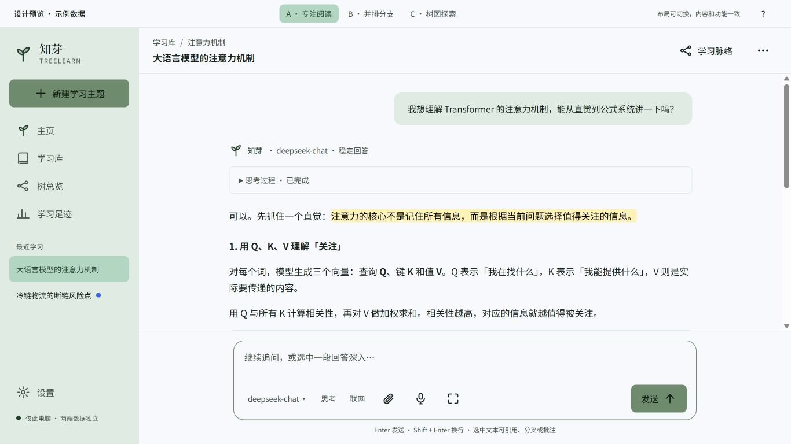
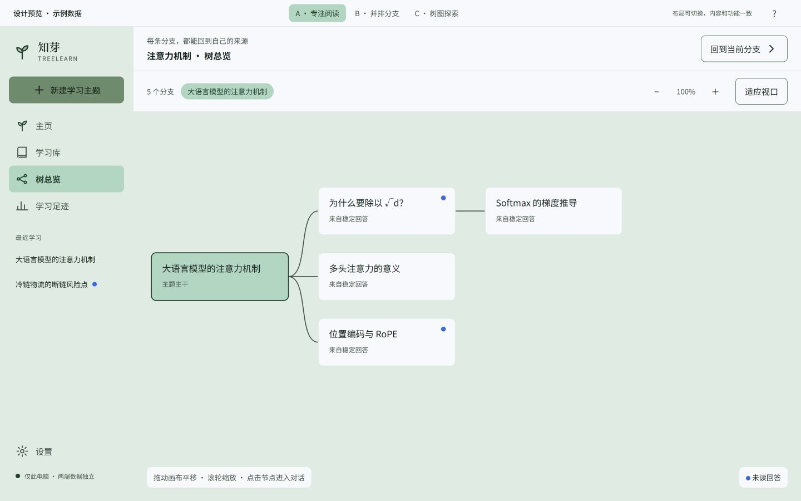
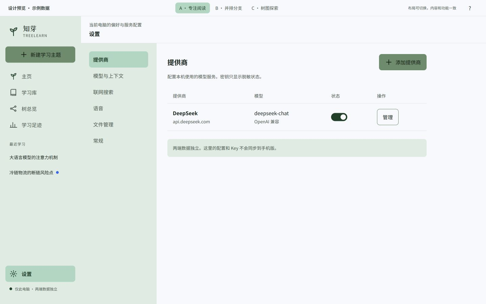
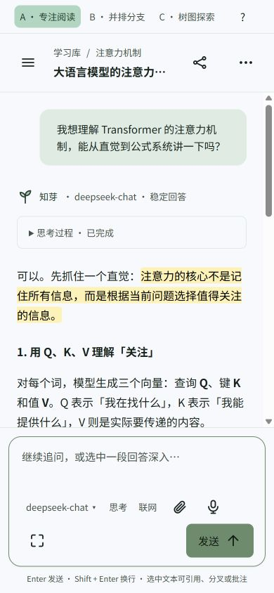

# 知芽 Web 本地版：原型说明 V0.1

日期：2026-10-10。使用 huashu-design 辅助设计；这是设计 review 产物，不是生产 Web 应用。

## 已确认的设计决定

- Web 与手机版的数据各自本地保存，不同步。
- A 专注阅读作为默认；B 并排分支和 C 树图探索可以切换。
- 薄荷雾面配色来自用户截图；图标轮廓与描边参考 [v1.1 原型](知芽-TreeLearn-高保真原型-v1.1.html)。
- 既有的间距、圆角、字号和阅读行高继续采用基础 token；Web 颜色在 [Web token 文件](web-local-design-tokens.json)独立定义，用户指定的颜色优先于旧 Web 方案中的生长绿映射。

## 打开与体验

双击 [HTML 原型](知芽-Web本地版-交互原型-V0.1.html)即可离线体验，不依赖 CDN、React 下载或本机业务服务。交互伴侣用同一 HTML 的生成副本展示，临时地址不是未来产品端口。

可按这条路径体验：

1. 在聊天页打开「学习脉络」，切换分支、来源、批注；关闭后正文恢复宽度。
2. 点击「分叉深入」，填写名称与首问，进入新分支；也可选中正文，使用浮条引用、分叉、高亮或批注。
3. 输入问题并发送示例回答；点击停止，看到部分内容与原位重试入口。
4. 切换 B 看来源对照，切换 C 看旁侧树图；打开树总览，缩放、平移或点击节点回到分支。
5. 从非根分支的操作菜单归档子树，在学习库恢复；根分支不可归档。
6. 从设置进入 Provider、模型、搜索、语音和文件页；返回分支后草稿仍在。文件删除有确认，说明缺失引用语义。

## 视觉来源与资产

- [用户配色参考图](web-local-assets/mint-palette-reference.png)已从临时附件保存到项目，避免交接后丢失。
- `web-white`、`web-mist`、`web-mint`、`web-sage` 是截图中的四个颜色；`web-on-sage` 是为主按钮可读性补充的深色文字。
- 品牌萌芽来自项目已有 vector，与 v1.1 的 ISprout 同源；HTML 内嵌品牌 SVG，图标 body 从 v1.1 的 Ic/I* 读取，不引入新图标库。
- 当前 Web 配色中主按钮的文字/底色对比约为 4.72，达到普通文字 AA；雾绿/薄荷背景上的次级文字使用既有 `ink2`，避免旧 `ink3` 在浅绿底上不达标。
- 样例学习内容来自已有原型的注意力机制主题，非真实用户数据。页面中的示例统计不代表真实使用情况。

## 原型的功能边界

- 已有页面导航、三种布局、分支进入/创建、来源与批注面板、模拟生成/停止、引用/选区、树图缩放/平移、草稿与读位置的页内保留、归档/恢复、设置与删除确认。
- 生成、翻译、语音、模型获取、Key 保存、数据库持久化、版本切换、完整文本容器映射等仍是演示；部分操作只展示状态或确认。
- 刷新 HTML 会回到示例数据；原型不向 Provider、手机、搜索或语音服务发送内容。Key 输入仅为界面演示，不应用于真实凭据。
- 正式功能一致性由 [功能矩阵](../05-technical-design/TreeLearn_Web本地版_功能一致性矩阵.md)验收；不能复制本原型的模拟代码作为真实业务实现。

## 本轮检查记录

以下是交互原型检查，环境为 Codex 内置浏览器；不代表正式 Chrome/Edge、Provider、语音或数据库验收。

| 场景 | 观察 |
|---|---|
| A 默认与侧栏 | 默认阅读宽列，学习脉络可展开，来源可切换 |
| 分叉与分支进入 | 创建对话框可编辑并进入新分支，侧栏出现新节点 |
| 设置返回与草稿 | 打开设置再回原分支，输入内容保留 |
| 模拟生成停止 | 生成中切为停止，停止后显示保留内容和原位重试 |
| 正文选区 | 鼠标拖选后出现浮条，引用操作把所选文字放入输入栏 |
| 批注 | 已有高亮可打开编辑，保存后批注侧栏展示新文本 |
| B/C | B 来源对照可见；C 的树图可见，切换不会改变领域关系 |
| 树总览 | 放大控件改变显示比例，点击节点进入对应分支 |
| 归档/恢复 | 非根子树归档后在库中显示；恢复父分支后后代重新可见 |
| 文件确认 | 删除显示确认层及保留缺失引用的说明 |
| 桌面与窄窗口 | 检查 1440×900、1366×768 与 390×844；窄窗口选主题后导航收起，文档根未出现横向溢出，小笔记本输入栏完整可见 |
| JavaScript | 主脚本语法检查通过；所测页面控制台 error 列表为空 |

点击检查发现的树图模式切换、归档组展示、隐藏按钮和窄窗口导航问题已在原型中修复，并复看相应路径。主规格轻量检查、UTF-8 和相对链接检查另在文档收尾执行。

## 截图

## 下一步

继续 review 可直接改这份独立 Web 原型。开发 AI 从 [交接入口](../05-technical-design/TreeLearn_Web本地版_AI开发交接入口.md)开始，读取需求、规格和功能矩阵后实现真实业务；布局主方向已经确认，不需要再重复问 A/B/C。
