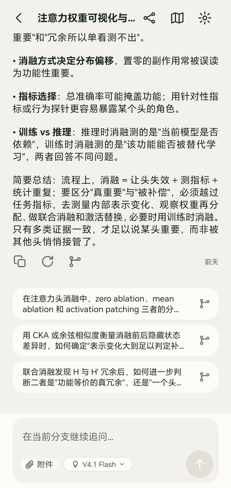
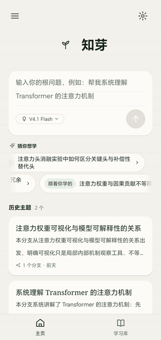
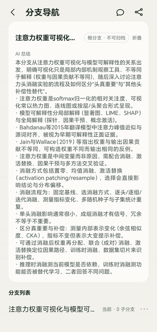
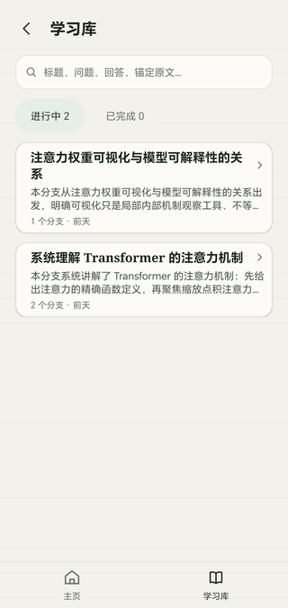

# 知芽 TreeLearn

> **把 AI 对话长成一棵树的学习助手。** 每一次追问，都有它该在的位置。



> **个人独立项目** —— 产品定义（PRD）、UX 设计、技术架构与研发，全部由本人一人完成。

- 📱 **[下载 APK 直接体验](https://github.com/menscn/TreeLearn/releases/latest)** —— 约 1.1 MB（2026-10-18 实测），Android 9 及以上，无需注册账号
- 📄 **[产品需求文档 PRD](Docs/03-prd-draft/V3.2-知芽（TreeLearn）产品需求文档（PRD）.md)** —— 想了解"为什么做成这样"，从这里开始
- 🎨 **[高保真交互原型](Docs/04-ux-design/知芽-TreeLearn-高保真原型-v1.1.html)** —— 浏览器直接打开，可点
- 🌐 **[English](README_EN.md)**

---

## 30 秒看懂：它解决什么

用普通 AI 聊天工具学一个陌生领域时，你大概遇到过这个情况：

> 问了 q1，读到回答 a1，心里冒出疑问 q2；顺着 q2 一路追问下去，回过神来 a1 已经被挤到很远的上面，再也找不到当时读到哪一行。

线性会话会把**不同回答衍生的追问按时间混排**，主线学习和临时探索互相打断，上下文也不再专一。

知芽的做法是：**把对话变成一棵树**。从一个根问题开始，你可以在任意一条"已经生成完的回答"上分叉出一条独立分支——分支有自己的隔离上下文，父分支后来新增的内容不会回头污染它。探索完，回到来源位置继续读。分支还能继续分叉，最后长成的形状就是你思考过程的形状。

它同时是一款 **local-first（本地优先）** 应用：数据全在你自己手机里，不注册账号、不云端同步、不上传使用记录。

---

## 你可以

- **在任意一条回答上分叉独立追问** —— 分支拥有隔离上下文，主线阅读不被打断；分支还能继续分叉。
- **回到主线继续阅读** —— 读到哪一行、哪个分支还没看完，下次打开还在原地；未读分支会被标出来。
- **划选回答里的一句话，直接引用它追问** —— 追问带着这段原文的锚点，不是重新描述一遍。
- **让 AI 给整条分支写一份总结** —— 分支导航页顶部就是这条分支的 AI 摘要。
- **归档没用的分支** —— 探索跑偏了可以整条收起来，主线保持干净。
- **搜索全部主题、问题与回答** —— 学习库按主题聚合，能按"进行中 / 已完成"筛选。
- **在首页直接开一个根问题** —— 不确定问什么时，"猜你想学"会滚动推荐切入点。
- **换模型、开关思考模式** —— 思考内容默认折叠，但会一并保存并计入后续上下文。
- **断网或生成失败时原地重试** —— 已经读到的内容不丢，界面保持上一次的样子。

---

## 界面一览

<table>
  <tr>
    <td align="center"><br><b>首页</b><br>输入根问题，或从推荐里挑一个</td>
    <td align="center"><br><b>分支导航</b><br>这条分支讲了什么、有哪些子分支</td>
    <td align="center"><br><b>学习库</b><br>全部主题、搜索与进度筛选</td>
  </tr>
</table>

除这四屏之外，还有一块**树状总览画布**：把整棵对话树画成可以缩放、拖拽、一键适配视图的图形，枝干长度随该分支的对话轮数增长，用来回答"我到底问出去了多远"。

---

## 5 分钟装上体验

1. 到 **[Releases](https://github.com/menscn/TreeLearn/releases/latest)** 下载 `app-release.apk`（约 1.1 MB）。
2. 传到手机后点开安装；系统提示"未知来源"时允许即可。
3. 打开 App → 右上角设置 → 填入你自己的 [DeepSeek API Key](https://platform.deepseek.com/api_keys)。
4. 回到首页，输入一个你真正想搞懂的问题，回车。
5. 读到想追问的地方，点回答下方的分叉图标 —— 树就开始长了。

Key 只保存在本机（Android Keystore 加密），所有请求由手机直连 DeepSeek，不经过任何第三方服务器。

<details>
<summary><b>从源码构建</b>（需要 JDK 17 与 Android SDK）</summary>

```bash
export JAVA_HOME=/path/to/jdk17
echo "sdk.dir=/path/to/Android/SDK" > android/local.properties
cd android
./gradlew :app:assembleDebug     # 产物在 app/build/outputs/apk/debug/
./gradlew check                  # 含依赖方向守门与 dex 级 Java-only 校验
```

APK 版本号统一维护在 `android/version.properties`；`./scripts/version.ps1 patch|minor|major` 递增，`./gradlew :app:printVersion` 查看 Gradle 实际注入的版本。
Release 签名的 keystore 存放在仓库之外，凭据只从进程环境变量读取（`TREELEARN_KEYSTORE_PATH` 等），其次读取已被 gitignore 的 `android/keystore.properties`。

</details>

---

## 技术选择

**一句话：Android 客户端主代码只用 Java，零第三方依赖。**

这不是复古偏好，而是给自己设的硬约束，理由是 APK 体积与运行期可预测性。当前 release 包约 1.1 MB、单个 dex 文件（2026-10-18 实测），主代码零第三方依赖、零 Kotlin 字节码。

约束靠机器守，不靠自觉：静态扫描 + Gradle 依赖报告 + **直接解析构建产物 APK 的 dex 字符串表**。

之所以要做到 dex 级别，是因为这个坑踩过一次：`androidx.test:monitor:1.6.1` 的 POM **完全不声明**任何 Kotlin 依赖，依赖图看起来干净，但它的 `OutputDirCalculator` 等 2 个类确实是 Kotlin 编译产物，设备上直接抛 `ClassNotFoundException: kotlin.jvm.internal.Lambda`。只看依赖图发现不了。

同理，主代码避开了 AndroidX —— `appcompat`、`core`、`test` 系列都会传递引入 `kotlin-stdlib`，所以界面层直接用平台 API 手写。

| 项 | 值 |
| :--- | :--- |
| Gradle / AGP | 8.14.3 / 8.13.2 |
| JDK | 17 |
| compileSdk / targetSdk / minSdk | 36 / 36 / 28 |
| 语言 | **Java-only**（主代码） |
| 第三方依赖（主代码） | **零** |
| 数据存储 | 手机本地 SQLite |

<details>
<summary><b>模块划分</b></summary>

```text
:app          ->  Activity / XML 视图 / 导航 / 依赖装配
:data  :ai    ->  :core
:core         ->  领域模型（纯 JVM，不引用 android.*）
:tree-layout  ->  树几何计算（纯 JVM）
```

| 模块 | 职责 | 明确禁止 |
| :--- | :--- | :--- |
| `:app` | Activity、XML 视图、导航、屏幕控制器、应用级生成协调器 | 不写 SQL，不拼 DeepSeek JSON |
| `:core` | 领域实体、状态机、用例、仓储与 AI 网关接口、供应商无关的提示词契约 | 不依赖 Android / SQLite / HTTP / Kotlin |
| `:data` | SQLite schema/DAO/事务/迁移、搜索、阅读状态、Keystore 密钥 | 不决定业务流程，不调用 DeepSeek |
| `:ai` | DeepSeek HTTPS/SSE、上下文编码、版本化提示词注册表 | 不操作 View / 数据库 |
| `:tree-layout` | 树几何、标签避碰、命中测试、视野拟合 | 不读数据库，不持久化像素坐标 |

</details>

<details>
<summary><b>核心概念</b></summary>

| 概念 | 含义 |
| :--- | :--- |
| **主题（Topic）** | 一棵完整的对话树。主题的显示身份直接复用**根分支标题**，不额外维护主题名——同一棵树永远只有一套名字。 |
| **分支（Branch）** | 树上的一条独立对话路径。根分支不可归档；非根分支可以整体归档或删除。 |
| **稳定回答（Stable Answer）** | 生成完成的回答版本。**只有稳定回答可以作为分叉来源**，部分回答只读、不可分叉。 |
| **创建快照（Context Snapshot）** | 分支诞生时被冻结的那段上下文背景。此后父分支的新内容**不会**回流污染子分支。 |
| **思考模式（Thinking Mode）** | 推理内容默认折叠展示、一并持久化，并计入后续上下文。 |

</details>

---

## 当前边界

项目仍在早期迭代，界面与交互按真实使用反馈持续调整。以下边界是刻意设计，不是遗漏：

- **AI 供应商目前只接了 DeepSeek**。多 Provider 是已冻结的增量需求，规格见 [`Docs/spec/SPEC-2026-09-23-providers-and-models.md`](Docs/spec/SPEC-2026-09-23-providers-and-models.md)。
- **不做云端账号、云同步与远程遥测**。规划中的 `backend/` 是**仅监听本机环回地址**的桌面服务，为 PC 端 Web 界面提供数据与密钥代理，不是远程服务器；范围与边界见 [`Docs/spec/SPEC-2026-10-15-web-h5-android-parity.md`](Docs/spec/SPEC-2026-10-15-web-h5-android-parity.md)。
- **Web/H5 端正在按"与 Android 逐屏等价"的方向复刻**，同一份规格约束两端，判据可机械复算。
- **Windows 桌面端复用同一份 Web 离线产物**，由 `desktop/` 的 Electron 壳装进标准窗口并打包为便携 exe，不另写界面与样式。

---

## 目录结构

```text
Treelearn/
├─ android/               Android 客户端（Gradle 多模块工程，Java-only）
│  ├─ app/                UI 层
│  ├─ core/               领域层（纯 JVM）
│  ├─ data/               本地持久化
│  ├─ ai/                 DeepSeek 网关
│  ├─ tree-layout/        树布局计算
│  └─ scripts/            守门与开发脚本
├─ frontend/              Web / H5 端（React + TypeScript + Vite）
├─ desktop/               Windows 桌面壳（Electron，加载 frontend 离线产物）
├─ Docs/                  需求 / PRD / UX 设计 / 技术设计 / 已交付规格
├─ assets/readme/         本README截图
├─ artifacts/             守门与验收证据
└─ .codex/                工程规则、角色与任务契约（AI 辅助研发流程入口）
```

<details>
<summary><b>文档索引</b></summary>

| 文档 | 内容 |
| :--- | :--- |
| [`Docs/01-demand/`](Docs/01-demand) | 结构化需求基准说明书 V3.0，以及 V3.1 / V3.3 增量 |
| [`Docs/03-prd-draft/`](Docs/03-prd-draft) | 产品需求文档 V3.2（当前基准）与 V3.3 多 Provider 增量 |
| [`Docs/04-ux-design/`](Docs/04-ux-design) | [高保真原型](Docs/04-ux-design/知芽-TreeLearn-高保真原型-v1.1.html)、[设计系统 token](Docs/04-ux-design/design-system)（Figma 与 Android 共用同一份数值）、逐屏清单 |
| [`Docs/05-technical-design/`](Docs/05-technical-design) | 本地优先技术架构、提示词设计、SQLite 建表确认 |
| [`Docs/spec/`](Docs/spec) | 已 accepted 并交付完成的功能规格 |
| [`android/README.md`](android/README.md) | 构建、守门、模块契约、常用命令与真机验证方式 |
| [`desktop/README.md`](desktop/README.md) | 桌面壳结构、启动/验收/打包命令与打包约束 |

</details>

---

## 工程方法

这个仓库是**一个人带一组 AI 代理做完的**，所以流程必须能被机器检查，否则第二天就散了。

`AGENTS.md` + `.codex/` 是本仓库的研发流程入口：需求先澄清并冻结边界，再按 ≤ 400 行预算拆成任务契约，实施强制 TDD 并留下 "RED → GREEN" 证据，最后由独立 verifier 按专项 guard 验收。

- `.codex/rules/` —— 按栈划分的规则与底线（Android / 前端 / SQL / 契约 / 共享状态 / 可观测性 / 可维护性）
- `.codex/tasks/` —— 任务契约文件，机械校验器 `.codex/scripts/validate_tasks.py`
- `.codex/scripts/` —— 项目专属守门脚本：Java-only dex 校验、设计 token 四方一致性、文档与代码事实对齐、逐屏清单
- `artifacts/evidence/` —— 每次守门与验收的执行证据，自带命令行与退出码
- 提交历史按 Conventional Commits 书写，`fix / feat / test / docs` 前缀带作用域，可以直接读

<details>
<summary><b>为什么文档也要写守门脚本</b></summary>

因为"当前有哪些技术栈"这类句子是**契约**，不是修辞——下一位实现者（人或 AI）会照着它决定要不要建目录。本仓库出现过 README 写着某个目录不存在、而该目录其实已经在跑的情况（该主张的当前权威见 `Docs/spec/SPEC-2026-10-15-web-h5-android-parity.md`）。

所以现在有一条机械判据：盘点清单不得被清空或截断（条目有下限）、已作废的方向短语不得残留（命中给到行号）、每个被盘点文件必须指向权威规格，外加一条与清单无关的模式兜底——`README*`、`.codex/rules/**`、`.codex/context/**`、`Docs/spec/**` 里任何一行只要还留着旧方向的形状，就必须**同一行**指回权威规格（引用历史要留指针，把历史当现状要判红）。跑法：

```bash
python -X utf8 .codex/scripts/dev/check_stack_facts.py
```

</details>

---

## 许可证

> **本项目不是开源项目，未授予任何开源许可证。**

代码受版权保护，未经书面许可不得使用、复制、修改、分发或用于商业用途。仓库公开可读**不构成**默示授权。完整条款见 [`LICENSE`](LICENSE)。

第三方依赖仍受其各自许可证管辖，本声明不覆盖这些组件。

---

Copyright (c) 2026 TreeLearn Project. All rights reserved.
