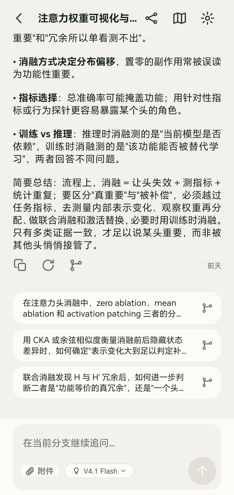
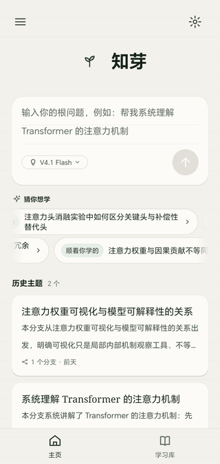
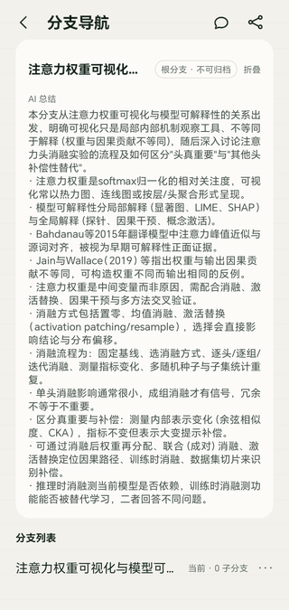
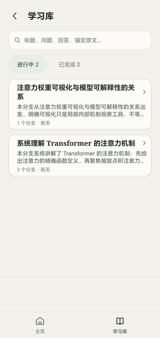

# 知芽 TreeLearn

> **A learning assistant that grows AI conversations into a tree.** Every follow-up lands where it belongs.



> **A solo project** — product definition (PRD), UX design, architecture and engineering were all done by me, alone.

- 📱 **[Download the APK](https://github.com/menscn/TreeLearn/releases/latest)** — ~1.1 MB (measured 2026-10-18), Android 9+, no sign-up
- 📄 **[Read the PRD](Docs/03-prd-draft/V3.2-知芽（TreeLearn）产品需求文档（PRD）.md)** — Chinese; the "why it is shaped this way" document
- 🎨 **[Hi-fi prototype](Docs/04-ux-design/知芽-TreeLearn-高保真原型-v1.1.html)** — opens in a browser, clickable
- 🇨🇳 **[简体中文](README.md)**

---

## What it solves, in 30 seconds

If you have ever learned an unfamiliar subject with a normal AI chat tool, you know this moment:

> You ask q1, read answer a1, and a doubt q2 pops up. You chase q2 for a while, and by the time you look up, a1 has scrolled far away — and your reading position is gone.

Linear chats interleave follow-ups that came from *different* answers in time order. Mainline study and side exploration keep interrupting each other, and the context stops being focused.

TreeLearn's answer: **turn the conversation into a tree.** Starting from one root question, you can fork an independent branch off any *completed* answer. The branch owns an isolated context — anything the parent branch adds later never flows back into it. When you are done exploring, you return to the exact spot you came from. Branches fork again, and the shape you end up with is the shape of your thinking.

It is also **local-first**: every byte stays on your phone. No cloud account, no sync, no usage telemetry.

---

## What you can do

- **Fork an independent follow-up off any answer** — the branch gets isolated context, so the mainline read is never interrupted; branches fork again.
- **Return to the mainline and keep reading** — the exact line you stopped at, and which branches are still unread, are restored next time you open the topic.
- **Select a sentence in an answer and ask about *that*** — the follow-up carries an anchor into the original text instead of a paraphrase.
- **Get an AI summary of a whole branch** — the branch navigation screen opens with it.
- **Archive a branch that went nowhere** — collapse a non-root subtree and keep the mainline clean.
- **Search across every topic, question and answer** — the library groups by topic and filters by in-progress / done.
- **Start a root question straight from the home screen** — a marquee suggests entry points when you are not sure what to ask.
- **Switch model, toggle thinking mode** — reasoning is collapsed by default but persisted and counted into later context.
- **Retry in place after a network or generation failure** — what you already read stays on screen.

---

## Screens

<table>
  <tr>
    <td align="center"><br><b>Home</b><br>Type a root question, or pick a suggestion</td>
    <td align="center"><br><b>Branch nav</b><br>What this branch covers and what forks off it</td>
    <td align="center"><br><b>Library</b><br>All topics, search and progress filter</td>
  </tr>
</table>

There is also a **tree overview canvas**: the whole conversation drawn as a zoomable, pannable graph, where each limb's length grows with the number of turns on that branch. It answers "how far out did I actually wander".

---

## Up and running in 5 minutes

1. Grab `app-release.apk` (~1.1 MB) from **[Releases](https://github.com/menscn/TreeLearn/releases/latest)**.
2. Copy it to your phone and install; allow "unknown sources" when prompted.
3. Open the app → settings (top-right) → paste your own [DeepSeek API key](https://platform.deepseek.com/api_keys).
4. Go back to Home and type a question you genuinely want to understand.
5. When an answer makes you curious, tap the fork icon under it — that is the tree starting to grow.

The key is stored only on the device (encrypted via Android Keystore), and every request goes phone → DeepSeek directly. Nothing passes through a third-party server.

<details>
<summary><b>Building from source</b> (JDK 17 and the Android SDK required)</summary>

```bash
export JAVA_HOME=/path/to/jdk17
echo "sdk.dir=/path/to/Android/SDK" > android/local.properties
cd android
./gradlew :app:assembleDebug     # output: app/build/outputs/apk/debug/
./gradlew check                  # dependency-direction guard + dex-level Java-only check
```

APK versioning lives in `android/version.properties`; bump it with `./scripts/version.ps1 patch|minor|major` and inspect what Gradle actually injected with `./gradlew :app:printVersion`.
The release keystore is kept outside the repository; credentials are read from process environment variables only (`TREELEARN_KEYSTORE_PATH`, …), falling back to the gitignored `android/keystore.properties`.

</details>

---

## Technical choices

**In one line: the Android client's production code is Java-only, with zero third-party dependencies.**

That is a constraint I imposed on myself rather than a preference, for the sake of APK size and predictable runtime. The release build is currently ~1.1 MB in a single dex file (measured 2026-10-18), with zero third-party dependencies and zero Kotlin bytecode in production code.

The constraint is enforced by machines, not discipline: static scan + Gradle dependency report + **parsing the dex string table of the built APK itself**.

The dex-level check exists because of a real trap: `androidx.test:monitor:1.6.1` declares **no** Kotlin dependency at all in its POM, so the dependency graph looks clean — but classes such as `OutputDirCalculator` are genuinely Kotlin compilation output, and the device throws `ClassNotFoundException: kotlin.jvm.internal.Lambda`. A dependency graph alone will never show that.

For the same reason production code avoids AndroidX entirely: `appcompat`, `core` and the `test` artifacts all pull `kotlin-stdlib` transitively, so the UI layer is written directly against platform APIs.

| Item | Value |
| :--- | :--- |
| Gradle / AGP | 8.14.3 / 8.13.2 |
| JDK | 17 |
| compileSdk / targetSdk / minSdk | 36 / 36 / 28 |
| Language | **Java-only** (production code) |
| Third-party deps (production code) | **zero** |
| Storage | SQLite on the device |

<details>
<summary><b>Module layout</b></summary>

```text
:app          ->  Activity / XML views / navigation / dependency wiring
:data  :ai    ->  :core
:core         ->  domain model (pure JVM, never references android.*)
:tree-layout  ->  tree geometry (pure JVM)
```

| Module | Owns | Explicitly forbidden |
| :--- | :--- | :--- |
| `:app` | Activity, XML views, navigation, screen controllers, app-level generation coordinator | No SQL, no hand-building DeepSeek JSON |
| `:core` | Domain entities, state machines, use cases, repository and AI gateway interfaces, vendor-neutral prompt contract | No Android / SQLite / HTTP / Kotlin |
| `:data` | SQLite schema/DAO/transactions/migrations, search, reading state, Keystore keys | No business flow decisions, no DeepSeek calls |
| `:ai` | DeepSeek HTTPS/SSE, context encoding, versioned prompt registry | No View or database access |
| `:tree-layout` | Tree geometry, label collision avoidance, hit testing, viewport fitting | No database reads, no persisted pixel coordinates |

</details>

<details>
<summary><b>Core concepts</b></summary>

| Concept | Meaning |
| :--- | :--- |
| **Topic** | One complete conversation tree. A topic's display identity *is* its root branch title — there is no second name to keep in sync. |
| **Branch** | One independent conversation path on the tree. The root branch cannot be archived; any other branch can be archived or deleted wholesale. |
| **Stable Answer** | A fully generated answer revision. **Only stable answers can be forked from**; partial answers are read-only. |
| **Context Snapshot** | The slice of context frozen at the moment a branch is born. New content on the parent never flows back into the child. |
| **Thinking Mode** | Reasoning content is collapsed by default, persisted alongside the answer, and counted into subsequent context. |

</details>

---

## Current boundaries

The project is still early; screens and interactions keep changing with real usage. These boundaries are deliberate, not oversights:

- **DeepSeek is the only provider wired up so far.** Multi-provider support is a frozen increment — see [`Docs/spec/SPEC-2026-09-23-providers-and-models.md`](Docs/spec/SPEC-2026-09-23-providers-and-models.md).
- **No cloud account, no cloud sync, no remote telemetry.** The planned `backend/` is a desktop service bound to **the loopback interface only**, providing data and key proxying for the PC web UI — it is not a remote server. Scope and boundaries: [`Docs/spec/SPEC-2026-10-15-web-h5-android-parity.md`](Docs/spec/SPEC-2026-10-15-web-h5-android-parity.md).
- **The Web/H5 client is being rebuilt to be screen-for-screen equivalent to Android**, under one shared spec so the parity claim stays mechanically re-checkable.
- **The Windows desktop app reuses the same offline Web bundle**, wrapped by the Electron shell in `desktop/` and packaged as a portable exe; it adds no UI or styling of its own.

---

## Repository layout

```text
Treelearn/
├─ android/               Android client (multi-module Gradle project, Java-only)
│  ├─ app/                UI layer
│  ├─ core/               domain layer (pure JVM)
│  ├─ data/               local persistence
│  ├─ ai/                 DeepSeek gateway
│  ├─ tree-layout/        tree layout computation
│  └─ scripts/            guard and dev scripts
├─ frontend/              Web / H5 client (React + TypeScript + Vite)
├─ desktop/               Windows desktop shell (Electron, loads the offline Web bundle)
├─ Docs/                  requirements / PRD / UX design / technical design / delivered specs
├─ assets/readme/         screenshots used in this README
├─ artifacts/             guard and acceptance evidence
└─ .codex/                engineering rules, agent roles, task contracts
```

<details>
<summary><b>Document index</b></summary>

| Document | Contents |
| :--- | :--- |
| [`Docs/01-demand/`](Docs/01-demand) | Structured requirement baseline V3.0 plus the V3.1 / V3.3 increments |
| [`Docs/03-prd-draft/`](Docs/03-prd-draft) | PRD V3.2 (current baseline) and the V3.3 multi-provider increment |
| [`Docs/04-ux-design/`](Docs/04-ux-design) | [Hi-fi prototype](Docs/04-ux-design/知芽-TreeLearn-高保真原型-v1.1.html), [design-system tokens](Docs/04-ux-design/design-system) (Figma and Android share one set of numbers), per-screen inventory |
| [`Docs/05-technical-design/`](Docs/05-technical-design) | Local-first architecture, prompt design, SQLite schema confirmation |
| [`Docs/spec/`](Docs/spec) | Feature specs that were accepted and shipped |
| [`android/README.md`](android/README.md) | Build, guards, module contracts, common commands, on-device verification |
| [`desktop/README.md`](desktop/README.md) | Desktop shell layout, run/verify/package commands, packaging constraints |

</details>

---

## How it is engineered

This repository is **one person working with a set of AI agents**, so the process has to be machine-checkable — otherwise it drifts by the second day.

`AGENTS.md` + `.codex/` is the process entry point: requirements are clarified and their boundaries frozen, work is split into task contracts under a 400-line budget, implementation is TDD with "RED → GREEN" evidence, and an independent verifier accepts each task against its specific guard.

- `.codex/rules/` — per-stack rules and baselines (Android / frontend / SQL / contracts / shared state / observability / maintainability)
- `.codex/tasks/` — task contract files, validated by `.codex/scripts/validate_tasks.py`
- `.codex/scripts/` — project-specific guards: dex-level Java-only check, four-way design-token consistency, doc-vs-code fact alignment, per-screen inventory
- `artifacts/evidence/` — evidence for every guard run, with the exact command line and exit code
- Commit history follows Conventional Commits with scoped `fix / feat / test / docs` prefixes, and reads like a project log

<details>
<summary><b>Why documentation gets a guard too</b></summary>

Sentences like "which stacks exist in this repo" are **contracts**, not prose — the next implementer, human or AI, decides whether to create a directory based on them. This repo has had a README claiming a directory did not exist while that directory was already running.

So there is a mechanical check: the inventory may not be emptied or truncated (it has a hard lower bound), obsolete direction phrases may not survive (hits are reported with line numbers), and every inventoried file must point at the authoritative spec.

```bash
python -X utf8 .codex/scripts/dev/check_stack_facts.py
```

</details>

---

## License

> **This project is not open source and grants no open-source license.**

The code is copyrighted. Without written permission you may not use, copy, modify, distribute it, and it may not be used for commercial purposes. The repository being publicly readable **does not** imply any license. Full terms: [`LICENSE`](LICENSE).

Third-party dependencies remain under their own licenses, which this statement does not override.

---

Copyright (c) 2026 TreeLearn Project. All rights reserved.
